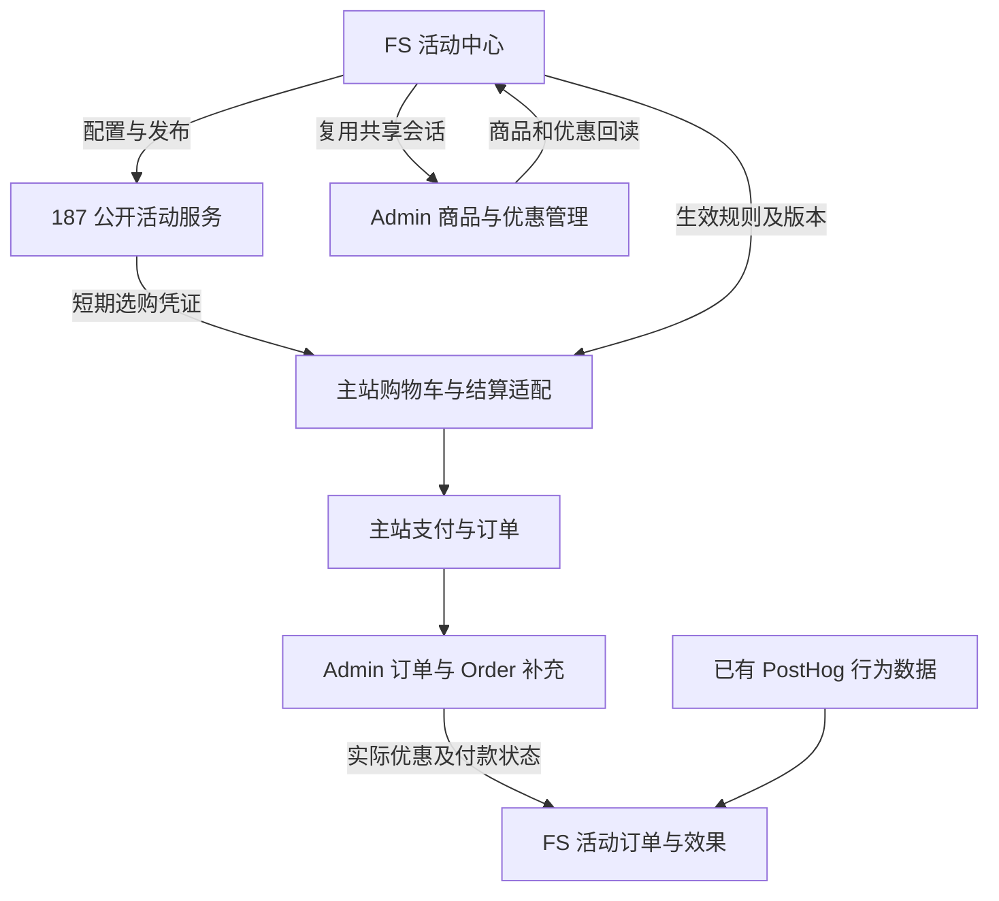

# FS 活动中心与双任务落地 Work 施工方案

## V3执行约束

本文件是原业务资料的执行参考副本，配套《FS双活动上线 Dot监工与Codex施工完整执行方案 V3》。组织、授权、任务调度和阶段安排以V3为准；本文W0—W9用于细化相应工程工作。

- 仅覆盖「策划 FC 活动与落地页」「设计 MMOEXP 限定活动页」。Matchday、竞猜和竞猜奖励明确排除；正常活动优惠券管理保留。
- 允许外部或Codex子Agent委托；老D向唯一本地Codex工程主控提出阶段要求，由主控调度专业子角色。
- 纯代码、构建和测试可在合适的本机或已配置云端环境执行，不再要求全部使用dot专用环境。
- 187操作通过实际能SSH到它的用户电脑和原通道执行，保持现有IP白名单。先核实Dot连接、本地任务、只读SSH和续派能力，不假设已打通。
- 原文件记录的仓库快照和后台线索用于复用定位。开工时核对当前源码、原任务接受版本、实际接口和生产状态，不把历史记录当成现场验收。

版本：V2.0  
日期：2026年10月24日，北京时间  
负责人：吴律  
执行对象：负责 FS 与 187 的 Work、两个原活动页任务，以及后续接入的 MMOEXP 主站技术  
目标阶段：二期完成 FS 与 187 侧可交付工程；三期完成主站适配及两个任务的真实业务闭环。

## 0 执行结论和本轮范围

保留「策划 FC 活动与落地页」「设计 MMOEXP 限定活动页」两个任务已经形成的页面和交互，在现有 FS 活动分析模块上增加活动经营配置、Admin 商品与优惠管理、187 独立页面发布、订单优惠归因和标准交易适配器。最终顾客在活动页选择商品、享受活动优惠，进入主站购物车使用原有账号及支付通道；主站允许的其他优惠按既定组合继续生效。

施工顺序确定为：

1. Work 先完成 W0—W7：源文件归档、现有接口复用、FS 活动中心、公开页面运行服务、商品与优惠配置、订单归因、联调适配器、187 部署与交付包。
2. 主站技术随后完成 T01—T07 中实际需要的接口、身份及结算适配。已有能力直接复用，不重复开发。
3. 双方完成 W8—W9：切换真实适配器、真实购买与奖励核销验收、正式域名读回及 FS 数据对账。

**二期交付可以验收为“FS 和页面可交付，主站交易待接入”；整个项目的完成条件必须是三期真实跑通。** 主站适配尚未完成，不妨碍推进其他工程，也不能据此把模拟下单标成正式成功。

### 0.1 用户本轮已确认的前提

| 事项 | 本方案采用的前提 |
|---|---|
| 通用券管理 | 主站已有，FS 曾有相关接口对接；优先查现有记录和消费者 |
| 购物车接入 | 主站可开发 |
| 商品属性 | SKU 之外存在平台、数量单位、规格等；由 Admin 产品模型及实际购买页获取 |
| 优惠叠加 | 主站可开发 |
| 订单活动信息 | 主站可开发适配；既有订单优惠可用于活动识别 |
| 订单详情 | Admin、Order 已有读取来源 |
| 后台权限 | 主站相关权限可开放，Admin 配置可由 FS 读写接口调用 |
| 活动订单统计 | 订单实际使用活动页的优惠配置，就追踪为该活动来源 |
| 先后顺序 | 先把本方 FS、187 和页面工程做好，再交主站技术适配 |

以上是施工前提，不再把“有没有券管理”“是否愿意开放权限”列为待用户确认问题。具体请求路径、参数和回执属于 W1 的技术核对工作。

### 0.2 范围边界

- 沿用原设计、素材、页面结构和已经接受的玩法；本方案不重新策划新一轮营销活动。
- “两个任务”不等于“两个 HTML 文件”。必须逐项登记两个任务的全部页面、功能和后端依赖。
- 管理界面复用 FS 登录、导航、样式和已有活动分析服务。
- 接入 Admin 与 Order 复用现有共享会话及取数消费者；不新建独立后台登录器。
- 187 对外发布顾客页面；主站继续处理正式购物车、最终优惠、支付、订单和履约。
- 主站结算尚未接通时，公开销售开关保持关闭，内部预览和技术验收可继续。
- 本文是施工与交接文件。本轮未执行生产部署、真实券创建、发奖或支付。
- 纯开发与测试按V3使用合适环境；187真实联调与发布通过原本机SSH通道执行，保持现有IP白名单，按项目现有PR与模块发布流程推进。

## 1 已确认的工程基础

本次源码核对基线：`wulv006-dot/FS-Workbench` 的 `2c976e7f849b3b7916e006dd6907e633051cb3fb`。这是本次读取的仓库快照，现场生产版本和原任务最新本地版本由 W0 对齐，不能整包覆盖生产。

### 1.1 可以直接复用的活动成果

| 成果 | 已读取的文件或内容 | 施工意义 |
|---|---|---|
| 活动模块 | `releases/fs-dashboard/campaign-analytics-20261023/` | 以此为候选基线核对现役源，不另建一套后台 |
| 每周好卡 | `app/Weekly-Scout.html`，`fc27-weekly` | 保留选卡、平台、清单等体验 |
| SBC 核心搭档 | `app/Sbc-Companions.html`，`fc27-sbc` | 保留“已有核心”与“购买代做服务”的差异 |
| Star Performer 三人组 | `app/Player-Trio.html`，`fc27-trio` | 保留三人组合和对应卡版本约束 |
| 商品目录 | `app/catalog.json` | 26 件产品记录的历史快照，采集时间为 2026-10-22；不是实时目录 |
| 商品/活动草稿 | `app/analytics/store.mjs` | 已有 revision、operationId、历史版本和冲突处理 |
| FS 分析入口 | `/dashboard/analytics/campaigns/analytics/` | 文档记录已有部署；本轮未现场验收 |
| 活动优惠设计 | `app/promotion-policy.json` | 当前售价基础上额外 10%，可按原规则组合 coupon、code、points |
| 统计 | `app/activity-analytics.js` 与 `ANALYTICS-INTEGRATION.md` | 保留已有 PostHog 行为协议与已登记 ID |
| SEO | `app/build-seo.mjs` | 已能从目录生成正文、SEO 片段、结构化数据和站点地图 |

证据见文末S01—S08。上述三页与两个原任务的归属由W0从实际文件和交接记录建立；用户已明确Matchday不属于本次，不再将其作为待确认项。

### 1.2 必须改造的具体位置

| 现有实现 | 当前限制 | 改造目标 |
|---|---|---|
| `host-adapter.js` | 限定 `https://www.mmoexp.com`；启用活动优惠时主动阻止 live 加购 | 保留安全检查，新增 187 独立站适配器和真实主站交接合同 |
| `activity-core.js` | 现有刷新逻辑拒绝 `has_sku` 或非空 `saleprop` 商品，购物车 `attr` 固定为空 | 建立商品规格描述及购买参数映射，按商品支持实际规格 |
| `catalog.json` | 固定 26 件历史商品，新增商品需要开发同步 | Admin 动态读取、筛选、核对、发布，允许日常新增和更换活动商品 |
| `store.mjs` | 只覆盖登记与有限商品编排 | 增加活动规则、优惠绑定、发布时间和交付状态 |
| `production-server.mjs` | 所有请求受 FS 内部登录保护，生成的活动配置强制 preview | 管理服务保留；新增公开页面服务，不直接暴露整个管理服务 |
| `build-seo.mjs` | 写死主站 origin，默认主站路径 | 使用经过配置的正式活动域名和路径构建全部产物 |
| 优惠配置 | 活动规则主要用于预览，`backendStatus=not_integrated` | Admin 真实规则绑定、主站兑现回执、按版本发布 |
| 分析 | PostHog 漏斗与本机联调为主 | 增加 Admin/Order 实际优惠命中订单账，保留原行为漏斗 |

不能通过删除 origin 检查、改成 `mode=live` 或把 `backendStatus` 改个字符串来宣布交易接通。[S02] [S03] [S04] [S05]

### 1.3 后台能力与证据状态

| 能力 | 已看到的依据 | 如何施工 |
|---|---|---|
| Admin 折扣码列表 | `GET /admin/market.Discount/index` | 复用现有分页读取 |
| Admin 优惠券模板 | `GET /admin/market.Coupon/index` | 复用现有分页读取 |
| 券使用记录 | `GET /admin/user.MemberCouponLog/index` | 按站点和订单号关联实际使用 |
| 商品模型 | `GET /admin/goods.GoodsMould/index`、`edit` | 读取模型与字段，不把 UI 地址当 JSON 接口 |
| 在售商品 | `GET /admin/goods.Goods/index`、`edit` | 对照实际购买页获得完整购买参数 |
| 已有商品写入 | `POST /admin/goods.Goods/edit`、模型相关客户端 | 按已实现的精确字段更新方式复用 |
| Admin 订单 | `GET /admin/order.Order/index` 及现有 ES 消费者 | 主经营事实、付款状态及优惠信息 |
| Order 补充 | 现有全局会话和订单、交付记录消费者 | 补充详情、成本和履约，按主站订单关联 |
| 券创建、编辑、发放、停用 | 用户确认业务能力；权限文档 D15 已列明 | W1 核实际写路由及回读，不凭 URL 命名猜测 |
| 商品 SEO、媒体配置 | 用户确认可开放相关权限 | W1 从现有客户端/后台动作补齐字段映射 |
| 新活动优惠与主站叠加 | 现有页面合同有要求；用户确认可开发 | 主站 T03 适配，二期完成 FS 配置与联调 |

已读代码中，券日志通过 `order_no` 关联，保留 `coupon_id`、`memberCoupon.grant_batch_no`、`use_time`、状态及日志 ID。订单已有 `discount_code` 读取。精确写路由和所有优惠金额字段仍需按现场合同验证。[S09] [S10] [S11]

旧统计模块“只读”的历史范围，不构成本项目永久禁止 Admin 写入的规则。新活动管理按本轮需求实现相应读写能力，但公开浏览器不能获得后台管理凭据。

## 2 二期和三期的交付目标

| 阶段 | 必须交付 | 不可冒充完成的事项 |
|---|---|---|
| 二期 FS 和 187 工程 | 两任务源文件清单、FS 管理、真实商品读取、优惠管理适配、页面和 SEO 构建、187 预览/内容部署、订单优惠归因、主站联调包 | 主站未接通的登录、购物车、叠加结算、奖励到账 |
| 三期主站接入 | 身份/购物车交接、最终报价、叠加及核销、优惠明细可追踪、实际订单关联 | 仅按钮跳转或仅测试适配器返回成功 |
| 最终业务验收 | 两任务每个在售页面对应真实业务闭环；竞猜若属于任务范围，还要完成参赛、发奖和核销 | 只验证三页中的一页，或用静态预览代替线上结果 |

二期按完整运营能力建设，不缩成只展示页面的一期。技术未适配的动作通过能力开关和明确状态隔离，其他工程继续。

## 3 目标架构与部署分工

### 3.1 187 的三个运行职责

1. **FS 管理端**：沿用当前内部入口、登录、权限和 UI；维护活动、商品、优惠、发布与分析。
2. **公开页面端**：仅提供已发布 HTML、素材、公开配置、公开商品报价投影和受控交接请求；不提供 FS 管理路由。
3. **后台任务端**：通过既有会话读取商品及订单、调用允许的 Admin 配置操作、构建页面、更新活动订单投影。

当前活动服务文档记录 `127.0.0.1:8948`，认证复用 `127.0.0.1:8895`。新公开服务端口由现场分配；不抢占既有端口、不将 8948 全部放开公网。[S01] [S05]

### 3.2 域名方案

默认建议正式活动域名 `promo.mmoexp.com`，属于待技术/DNS 配置的方案名。域名由主站团队分配，公开内容从 187 的隔离入口读取；部署全过程使用 HTTPS。

兼容技术选择 `www.mmoexp.com/events/...` 反向代理，但它是另一种正式路由配置，不能同时形成两套独立内容发布。主站目录方案需按主站同源脚本管理要求执行。

二期将 `public_origin`、`base_path`、`main_checkout_origin`、`asset_base_url` 和语言路径配置化。正式域名尚未分配时使用受控预览入口，不以 IP 预览地址提交 SEO 收录。主站适配完成后继续由 FS 发布页面，技术不再维护另一份页面副本。

## 4 商品目录和购买属性

### 4.1 建立一份可维护的商品投影

商品信息读取 Admin 模型、实际在售商品和公开购买页对应接口。FS 保存用于展示与核对的投影，正式价格和可售资格仍由主站在报价及下单时确认。

| 字段组 | 需要保留的内容 |
|---|---|
| 主体 | 主站站点 ID、Admin 游戏 ID、Order 游戏 ID 映射 |
| 产品 | 模型 ID、实际在售商品 ID、SKU/规格 ID（如存在） |
| 平台 | 平台代码、后台属性 ID、前台名称 |
| 数量 | 购买数量、数量单位、最小数量、步长、数量组、交付量/赠送量（适用时） |
| 规格 | 属性定义、可选值 ID、已选属性、主站所需序列化格式 |
| 内容 | 标题、卡版本、图片、说明、交付要求、原商品 URL |
| 可售 | 上下架、自动下架、服务可用状态、规格兼容状态 |
| 价格 | 原币种、当前售价、价格来源与时间、价格版本、有效期 |
| 追溯 | 采集时间、校验状态、目录版本、修改人及发布版本 |

`goods_id`、`model_id` 和 `sku_id` 分别保存，不统一伪装成一个 SKU。已有 FC 样本中站点为 266、Admin 游戏为 1327，PS/Xbox/PC 属性 ID 为 21587/21585/21589；这些是源码样本值，不替代 W1 的实时映射校验。Order ID 使用单独命名空间。

### 4.2 具体工作

- 复用 `shared_backend_session` 与已有商品消费者；增加查询、分页、关键字、平台和品类过滤。
- 从固定 26 件目录升级为可检索商品池；选中商品后同步其真实素材和属性。
- 将 `attr:''` 的固定参数改为经过属性映射的购买参数；遇到不支持的规格，仅阻止该规格购买并说明缺项。
- 商品卡、清单、购物车请求保持同一商品身份和属性，不用同名商品替代缺失平台。
- 新增商品不要求运营改 `catalog.js`；构建时由已保存配置生成。
- 每次发布与购买前重新核对商品状态。历史快照可用于内部展示，不得宣称为实时报价。
- 币种、小数精度和汇率由主站合同确定，不能把所有币种都按两位小数或美元处理。
- 游戏金币的购买量、赠送量及发货量沿现有业务口径；活动百分比优惠不自行修改赠送和履约数量。

### 4.3 日常编辑与主站写入区分

活动排序、活动文案、页面配图、推荐组合属于 FS 页面配置。修改主站商品名称、图片、SEO 或状态属于 Admin 业务写入，操作界面应显示影响对象及修改前后值，并沿原接口精确更新。

不要把一个活动页的局部标题自动覆盖成所有主站入口的商品标题。主站通用商品编辑能力可以接入 FS，但要与活动展示字段明确区分。

## 5 FS 活动中心界面

在既有活动模块中扩展，不重新搭一套登录或独立管理网站。

| 页面 | 主要能力 |
|---|---|
| 活动列表 | 任务归属、活动 ID、页面版本、时间、内容状态、交易接入状态、已归因订单 |
| 活动编辑 | 页面类型、商品编排、文案素材、语言、平台、活动条件 |
| 商品与素材 | Admin 检索、规格预览、当前价格、同步状态、购买参数检查 |
| 优惠与券 | 主站券码读取、活动绑定、新建/编辑/启停、试算、核销和异常回执 |
| 发布与联调 | 构建、预览、差异、发布记录、主站能力检查、交付包 |
| 订单与效果 | 活动优惠命中订单、实收、优惠成本、退款、PostHog 漏斗 |

界面保持 FS 现有导航和视觉体系。当前值、保存草稿、已发布版本分别显示。加载失败不显示为零；未接通不显示为成功；未知写入结果引导核对原操作。

正文、商品目录、活动规则、SEO 和公开配置由同一发布版本生成。运营修改后不再需要人工导出 JSON、找开发重新生成静态页面才能完成普通更新。

## 6 优惠管理和实际生效

### 6.1 复用主站管理能力

FS 对 Admin 提供统一适配层，至少支持：

- 查询折扣码、优惠券模板、有效期、站点/游戏/商品范围、状态和用券日志。
- 按真实已开放动作新建、编辑、启停活动优惠或券模板。
- 需要定向发券的既定玩法，调用已有发放能力并记录批次、会员券引用和结果。
- 对活动优惠完成读回，校验折扣、门槛、适用对象和状态。
- 用主站返回的实际 ID 建立绑定，不依赖运营手填券名字或“都是九折”识别。
- 主站不支持的叠加类型保留为“待技术接入”，不以普通单码替代后声称已实现双重优惠。

W1 查清实际写入方法、参数、幂等方式和查询回执。不能由 `/index` 推断出存在 `/add` 或 `/edit`，也不能把“保存请求超时”当作失败后换操作 ID 重发。

### 6.2 活动优惠与通用券分层

沿用现有页面规则：以当前售价为基础计算活动额外优惠；后续 coupon、code、points 按主站原有互斥与适用规则组合。[S02]

活动额外 10% 应作为独立活动优惠或主站支持的独立优惠层。若主站只有一个普通优惠码位置，不能把活动码放进去再覆盖用户原码来冒充叠加。

建议活动规则保存：

| 规则字段 | 含义 |
|---|---|
| `activity_id / rule_version` | 稳定活动 ID 与不可变规则版本 |
| `native_benefit_ref` | 实际主站规则/券模板/发放批次引用 |
| `eligible_products` | 适用商品、平台和规格 |
| `discount_type / value` | 百分比、固定金额等已支持类型 |
| `baseline` | 当前真实售价或明确指定的主站价格层 |
| `stack_policy` | 允许的券、码、积分类型及互斥条件 |
| `minimum_spend / maximum_discount` | 门槛口径及封顶金额 |
| `valid_from / valid_to` | 生效区间和业务时区 |
| `redemption_limits` | 次数、人数、预算等已支持约束 |
| `profit_policy_ref` | 本品类实际采用的利润保护规则 |
| `upstream_revision / verified_at` | 主站规则版本与最近读回时间 |

限制次数和预算的最终核销必须在主站交易执行侧原子判断，不能只靠 FS 定时统计后的剩余数控制并发付款。

### 6.3 利润规则按品类适用

现有 `promotion-policy.json` 明确要求采用各商品品类批准的利润规则，不继承 Coins 的统一底线。[S02]

- FC Coins 若纳入活动，继续遵守其现行定价和所有合法优惠组合检查。
- Players、SBC、Packs、固定捆绑包按本品类的实际合同核算；不自动套用 Coins 的 10% 采购毛利底线。
- 优惠试算需要显示完整组合；新客优惠资格由主站确认。
- 缺失实际成本或价格时显示待核，不能把经营报表参考毛利率当作采购报价。
- 活动发布不顺带触发全站自动改价策略调整。

### 6.4 幂等与未知写入

所有后台配置写入保存 `operation_id`、对象、修改前后值、请求摘要、响应摘要、上游引用和读回结果。

状态至少包含 `pending / confirmed / rejected / unknown`。对于 `unknown`，优先查询原对象、原批次、原操作；只有证明未执行后才决定重试。发券和发奖不能依赖浏览器再次点击来重放。

## 7 活动归因以实际优惠为准

本节是用户本轮口径，覆盖旧活动说明中“不能仅凭优惠识别活动订单”的限制在**经营归因**上的适用。原有行为漏斗仍按真实事件计算，两者不相互伪造。

### 7.1 业务判定

**订单实际应用了本活动绑定的优惠配置，且主站确认有效付款，就计为该活动来源的已支付订单。**

- 不要求该订单一定有 PostHog 访问 ID。
- 不因广告拦截、未同意行为统计或跨设备而排除真实优惠订单。
- 只领券未使用、只生成结账、未支付、优惠被移除，分别保留状态，不计已支付活动订单。
- 同一个通用券在全站使用，不因它恰好也是 10% 就归入活动。
- 活动优惠被分享后在别处核销，仍按用户规则计入活动优惠来源；“真实访问过活动页”仅在有对应行为证据时展示。

### 7.2 优惠绑定必须可区分

建立 `activity_benefit_bindings`，至少保存：

`site_id, activity_id, rule_version, benefit_kind, upstream_benefit_id, coupon_template_id, grant_batch_no, valid_from, valid_to, status`。

其中 `benefit_kind` 根据实际能力区分活动规则、折扣码、券模板、发放批次。必须使用稳定 ID 或精确批次；只用名称或百分比不合格。

现有目录的优惠上层 ID 是 `fc27-season2`，页面 ID 是 `fc27-weekly / fc27-sbc / fc27-trio`。要分别统计三页，应让每页具有可区分的主站优惠引用或发放批次；如果主站只能返回共同引用，先准确归到活动组，不强行分摊到页面。三期补齐页面级引用后才能验收页面级订单归因。

同一优惠引用不能在同一生效时间被多个无关活动重复认领。规则修改保存新版本和生效区间，历史订单保留当时映射，不用最新配置覆盖历史。

### 7.3 读取和识别流程

1. 复用现有 Admin 订单读取结果，选择本项目站点和目标订单。
2. 读取订单优惠明细；结合 `discount_code`、券日志 `coupon_id`、批次和主站活动优惠引用。
3. 按实际优惠引用与有效版本匹配活动。
4. 用主站付款状态与付款时间确定是否计为已支付。
5. 通过订单号关联 Order 补充详情及成本，不从 Order 全量混入 ELD/G2G 分销订单。
6. 更新活动订单事实表并去重；退款、取消、优惠撤销追加状态变更。

目前券日志的 `use_time` 只证明有使用记录，不能单独当作付款时间；必须关联订单状态。[S09] [S10]

### 7.4 订单和金额展示

| 指标 | 定义 |
|---|---|
| 活动已支付订单 | 命中活动优惠且有效付款的唯一订单数 |
| 活动关联整单实收 | 这些订单的整单实收；明确包含混合购物车其他商品 |
| 活动商品实收 | 有可靠商品行优惠分摊时，活动商品行实际支付金额 |
| 活动优惠金额 | 主站记录的活动层实际减免 |
| 其他优惠金额 | 主站码、券、积分等分别记录 |
| 退款金额 | 真实退款状态及金额，保留原付款记录 |
| 优惠核销率 | 实际核销/符合所选批次定义的发放量，分母口径明确 |
| 毛利 | 只有相同币种、实际收入和可匹配成本齐备时计算 |

混合订单没有商品行分摊时，可以展示关联整单实收，活动商品实收显示“待分摊”；不按照前端标价猜测。多个活动共同命中同一订单时，单活动相关订单数可重叠，活动总览按订单去重，相关整单金额不可直接相加。

## 8 PostHog 与后台订单数据的组合

保留已有 PostHog 项目、事件桥、同意管理和查询模块，不另建第二套行为追踪。

- PostHog 负责浏览、商品曝光、选购、查看清单、点击等真实行为。
- 正式加购和进入结账事件只由真实业务回执触发。
- Admin/Order 负责本方案的活动已支付订单、优惠、退款和经营事实。
- 有访问上下文时可关联行为漏斗；缺上下文时进入“已归因订单、访问未关联”集合，不能补造前置浏览事件。
- 订单后台读取足以支撑首版经营归因，主站新增 Webhook 是及时性优化，不作为二期必须等待的工程。
- 如果未来向 PostHog 回填可信付款事件，使用统一事件去重键和原付款时间；无行为统计同意/可用身份时，不为追求完整漏斗伪造浏览器身份。

当前漏斗按访问起始日、UTC、24小时顺序窗口计算；活动订单按实际付款时间统计。FS 默认运营展示时区使用北京时间，界面明确展示漏斗时区和窗口，不能直接用“当天付款订单/当天浏览量”冒充同批次转化率。[S06]

刷新优先消费已有 Admin/Order 数据与缓存。需要更及时的活动数据时，通过同一消费者请求增量刷新；不新建第二个全站订单采集器。支持更新时间时用更新时间水位；仅有付款时间时使用重叠付款窗口并复查活动未终态订单及退款监测集合。对超出监测窗口的历史状态变化，显示覆盖范围并提供按订单重查，不能宣称所有历史退款已实时同步。

## 9 交易交接设计

### 9.1 二期先实现的标准接口

FS 和页面先实现统一适配器，约定以下动作；具体正式主站路由由技术绑定：

- `capabilities`：已接通的商品报价、活动优惠、购物车、身份、发券等能力。
- `quote`：校验商品、规格、数量、币种、规则版本，返回有效报价和优惠拆分。
- `prepare_checkout`：生成选购意图和幂等操作，取得主站交接凭证。
- `lookup_checkout_operation`：查询原交接结果。
- `identity`：需要会员身份的玩法获取主站可信身份。
- `benefit_readback`：读取已发布优惠状态。

上述名称是本项目适配合同，不是已存在的 Admin URL。

### 9.2 顾客路径

1. 在 187 页面选商品、平台、规格和数量。
2. 点击核对清单，刷新可售状态与价格。
3. 通过 FS 服务端向主站创建交接，浏览器只携带短期凭证。
4. 主站在自己的会话中验证并合并购物车，保留原购物车及活动商品归属。
5. 在主站选择允许的其他优惠，核对最终金额并支付。
6. FS 从原有后台读取付款及优惠详情，完成活动订单归因。

公开页面不直接持有 Admin/Order 账号、Token，也不代顾客使用管理账号购物。主站 Cookie 保留原域和安全范围，不为跨域方便改成所有子域共享管理员或客户会话。

### 9.3 未接通时的行为

- 内部联调使用明确的 `integration_test` 适配器；返回虚构数据时有固定联调标识。
- 正式配置缺少主站能力时返回 `MAIN_INTEGRATION_REQUIRED`，不给假结算链接。
- 可以提供“前往主站查看商品”的普通链接，但明确它不能证明活动优惠已承接，不能计作活动结账成功。
- 预览、联调、真实交易使用独立模式和数据分区；仅修改前端配置不能启动真实优惠。
- 不以 iframe 嵌入、自动跨域点击主站按钮或直接转发顾客 Cookie 作为正式交易接入。

## 10 排除的竞猜范围

Matchday、竞猜报名、赛果和竞猜奖励不属于本次，不安排相关身份桥、状态机或发奖工程。普通活动券的配置、必要发放、使用、停用和订单关联继续按原业务范围实现。正常购物登录与会话归入T02。

## 11 发布和生效状态

### 11.1 三类状态分别记录

| 状态轴 | 建议状态 |
|---|---|
| 页面内容 | 草稿、已构建、预览可用、已发布、已归档 |
| 主站接入 | 未接入、联调中、已通过、不可用 |
| 业务活动 | 未开始、进行中、暂停中、已暂停、已结束 |

不要只提供一个“已上线”标签。页面可以已发布但真实购买未开放；主站优惠撤销尚未确认时显示“暂停中”。

### 11.2 发布过程

保存草稿 → 校验商品和规则 → 构建页面/SEO/公开配置 → 读取 Admin 真实配置 → 确认主站能力及规则版本 → 发布不可变页面版本 → 实际入口读回。

二期在“等待主站接入”处完成内容交付，其余检查不停止。三期取得真实适配回执后才开启购买。

发布记录包含 `release_id`、源提交、目录版本、规则版本、正式 origin、构建摘要、Admin 回读、主站适配版本、发布人和读回结果。

### 11.3 活动结束和暂停

页面倒计时、FS 活动状态、主站规则有效期要一致。结束后停止新活动资格；已创建订单和已发券按其冻结有效期及主站现有规则处理，不能用改页面文案的方式改变已承诺权益。

暂停既要阻止公开入口创建新交接，也要调用并读回主站规则停用结果。旧订单、已发券、退款和核销记录保留。

## 12 SEO 和素材构建

- 沿用已有 `build-seo.mjs`、页面片段和素材；改为正式域名、路径和语言可配置。
- 将只允许主站 origin 的断言改为来自部署配置的明确白名单，不改成接受任意 URL。
- 每次构建同步 HTML 正文、标题描述、canonical、分享图、结构化数据、站点地图和公开活动配置。
- 当前三页默认语言是中文预览；海外正式入口应使用既定英文版或主站实际语言策略，保持已实现的中英文体验。
- 预览页不收录；正式入口具有自洽 canonical；不同时让 IP、预览、子域名和主站代理副本都成为独立正式页。
- 商品素材保留来源与更新信息；图片失败有占位，不能阻断整个页面。
- 集合页的结构化数据按页面真实内容选择；不把未经核验的预览优惠写成可兑现的正式报价。
- 所有官方域名、具体页面路径在正式分配后统一改配置并重建，不手改多个静态副本。

## 13 数据和版本管理

优先复用已有活动存储及模块数据目录。原有 `state.json`、revision 和 history 保留。若需要订单、发奖等事务记录，使用模块独立的事务存储；选型遵循现场已有依赖，不为此引入全站数据库迁移。

| 数据对象 | 核心内容与约束 |
|---|---|
| 活动登记 | 两任务归属、activity_id、类型、负责人、状态；历史 ID 不复用 |
| 页面版本 | 设计源、页面路径、构建版本、素材/SEO版本、正式地址 |
| 商品绑定 | 模型/在售商品/规格/平台/数量、校验结果及来源时间 |
| 优惠绑定 | 上游真实引用、活动版本、生效区间、唯一归属 |
| 发布操作 | revision、operation_id、变更摘要、结果和上游回执 |
| 选购意图 | 匿名意图 ID、商品选择、规则版本、到期、主站交接引用 |
| 活动订单事实 | site+order 唯一键、付款/优惠/退款、映射版本、金额精度 |
| 活动商品行事实 | 原订单行引用、活动归属、实际分摊、待核原因 |
| 竞猜与奖励 | 原报名键、赛事版本、资格、发券操作、批次、到账/核销状态 |

当前配置操作只保留最近100条的机制适用于现有草稿编辑，不足以单独承载长期发券去重。真实优惠写入、发券、结账交接需要可持久查询的操作账本。[S15]

模块升级要保留旧活动和旧报表，先备份并做可回读迁移；回退程序版本不直接回退已产生的订单、核销和发奖事实。新增公开配置采用字段白名单，原始后台响应、身份信息、密钥和成本不对外返回。

## 14 主站技术适配边界

详细合同见配套《MMOEXP 活动页主站技术接入合同》。这里明确分工：

| 编号 | 主站技术工程 | FS/Work 先做什么 | 进入正式业务的条件 |
|---|---|---|---|
| T01 | 正式活动域名、HTTPS、入口链接或代理 | 域名可配置、构建产物、公开服务和部署说明 | 正式入口实际读回 |
| T02 | 权威报价、购物车交接和原会话绑定 | 商品参数映射、选购意图、适配器、联调用例 | 真实商品正确入车，重复请求不重复加入 |
| T03 | 活动优惠与券/码/积分组合执行 | FS 规则、Admin 引用、试算、版本合同 | 最终价格及优惠拆分与规则一致 |
| T04 | 活动优惠在订单详情中的可追溯字段 | 优惠绑定表、订单读取和识别器 | 原后台能识别真实活动优惠 |
| T06 | 现有券管理实际缺失的动作或范围 | 复用现有读写消费者、返回缺口清单 | 指定操作及回读通过 |
| T07 | 交易结果即时通知，可选 | 原后台拉取对账，幂等入口合同 | 仅为及时性优化，不阻塞基础归因上线 |

主站无需为每个活动页重新开发一套购物车或复制 FS 后台。T06 只有在 W1 发现现有接口确实缺动作时才列入技术待办；不能把已经存在的券管理重新安排成必做新系统。

## 15 Work 施工步骤

### W0 锁定两任务成果和现场维护源

**输入**：两个原任务的当前工作目录、交付文件与记录；本方案已定位的仓库文件；187 现役服务、发布索引和权限。

**动作**：

- 逐一查找「策划 FC 活动与落地页」「设计 MMOEXP 限定活动页」的真实源和最新接受版本。
- 对照两个原任务及三页促销包，建立“任务→页面→业务功能→源码→正式计划路径”清单。
- 通过既有本机通道核对 187 实际维护路径、服务和已部署版本；仓库 release 只是候选证据，不是任意覆盖源。
- 记录原页面桌面、移动端关键状态及已接受文案，不重新设计一套替代品。

**产物**：`SOURCE-MAP.md`、`ACTIVITY-PAGE-MANIFEST.json`、`BASELINE.md`。页面清单至少含原任务名、source_path、source_commit/hash、page_id、activity_id、功能、身份要求、优惠要求、技术依赖。

**完成条件**：两个任务全部页面有归属；不能以找到了三页源码就默认覆盖了两个任务。若一个原任务源码确实暂不可取，明确阻塞该任务的适配，继续公共层及另一任务工程。

### W1 核对并封装已有后台能力

**动作**：

- 复用 Admin 8767 与 Order 8768 共享会话消费者，不另写登录和 Token 缓存。
- 完整分页读取券码、模板、订单优惠日志；现有 `admin_links.inventory` 只显示一页且标 partial，不能拿它的返回总数当完整主站券库。
- 查询商品模型和在售商品，抽取购买属性、规格序列化和数量口径。
- 对 Admin 的券读写、图片/SEO等本项目所需动作建立能力表。已有写动作直接复用；未知路径在正式后台对应操作或已保存请求记录中核对。
- 有测试环境或禁用草稿能力时验证最小受控读写及回读。不能以读取成功证明创建/停用成功。
- 新客资格、会员券归属等交易判断留给主站实际身份和优惠模块。

**产物**：`CAPABILITY-MATRIX.md`、`ADMIN-FIELD-MAP.json`、`ORDER-FIELD-MAP.json`、现有 API 客户端封装。

**完成条件**：每项能力标为“源码已定位、现场读取通过、现场写回通过、待主站适配”之一；未知字段有明确降级和后续位置，不要求用户重新回答已确认的权限问题。

### W2 商品和素材中心

**动作**：完成动态商品搜索、规格与数量映射、主站素材接入、可售校验、版本化目录、价格刷新和缺项提示。

**产物**：商品投影、商品编辑 UI、两个任务各自的正式候选商品清单。

**完成条件**：运营可在 FS 添加或替换真实商品，无需修改 JS；至少覆盖当前三页所需 Players、SBC、固定包及三平台；新增其他品类按 W0 实际清单覆盖。

### W3 优惠中心和活动配置

**动作**：接通已有券管理、活动规则编辑、上游引用绑定、叠加试算、时间/版本/状态、启停回读和未知结果对账。

**产物**：优惠管理 UI、活动配置存储、benefit binding 表、试算结果、上游操作账本。

**完成条件**：规则保存、主站现有配置状态和“交易是否支持叠加”分别可见；现有三页 10% 与 coupon/code/points 合同完整保留，主站原互斥规则仍有效。

### W4 187 公开运行层与标准适配器

**动作**：新增隔离公开服务，配置域名和静态资源；实现能力检查、商品查询、选购意图、报价/交接接口与测试适配器；管理服务继续受 FS 权限保护。

**产物**：公开运行服务、环境配置样例、统一页面 SDK/适配层、联调服务。

**完成条件**：页面在 187 环境独立运行；未接通主站时明确不能真实购买；没有把管理端认证取消以便公开页面访问。

### W5 接入两个任务的全部页面

**动作**：

- 三页促销保留 weekly/trio/sbc 的已有交互、固定包和中英文体验。
- SBC“已有核心”不加入核心商品和金额；“代做服务”加入正确服务及搭档。
- 三人组按真实卡系列规则校验，不把替换图片当作更换商品。
- 通过公共商品与优惠配置更新页面，不为每页复制一套价格算法。
- 改造 SEO 构建的域名、语言和路径，生成所有内容产物。

**产物**：两个原任务各自的可运行页面集、业务适配代码、构建脚本、素材来源记录。

**完成条件**：按 W0 页面清单逐页覆盖，原有业务选择在新环境中保持一致；不以重新制作的简化页面替代原成果。

### W6 订单优惠归因与活动分析

**动作**：复用 Admin/Order 消费者，识别实际优惠引用，按主站付款状态建立活动订单事实；增加整单与行实收、优惠、退款和成本覆盖；将现有 PostHog 漏斗接入相同活动 ID。

**产物**：活动订单识别器、增量/重查任务、FS 效果页面、数据口径说明。

**完成条件**：有优惠且支付的订单即使没有浏览事件也入账；无活动优惠的全站通用券不误归因；多活动订单全局去重；缺少分摊时不伪造行金额。

可用真实历史订单验证后台字段和付款/退款读取，但未真实使用新活动优惠的历史订单不得事后改标为新活动成交。

### W7 部署二期内容与交付包

**动作**：通过现有 PR 与模块发布器部署管理端和公开预览内容，完成真实入口、权限、保存恢复和数据读取验证；生成主站技术接入包。

**产物**：`FS-READY-ACCEPTANCE.md`、`MAIN-SITE-TODO.md`、开发交付包、部署及回退说明、可访问的预览地址。

**完成条件**：满足二期全部验收；主站缺失项按 T 编号列明。真实购买开关只在满足主站能力时开启，未完成项不影响合格的内容交付。

### W8 主站联调与真实适配切换

**执行方**：主站技术 + Work。

**动作**：主站按 T01—T06 对接；Work 将测试适配器替换为正式适配器，校验参数、报价、规则版本、会话、购物车和订单优惠回读。

**产物**：`MAIN-INTEGRATION-ACCEPTANCE.md`、正式能力回执、字段最终映射、失败与重复处理证据。

**完成条件**：主站不需要复制并独立维护页面源码；同一页面通过配置和适配器切换即可接通。

### W9 两任务正式业务验收

**动作**：按原页面清单逐页验证代表性真实业务路径；完成原站支付及后台读回、活动优惠归因；正式域名和配置再读回。

**产物**：`FINAL-ACCEPTANCE.md`、逐任务/逐页完成矩阵、真实订单关联记录、后续运营操作说明。

**完成条件**：所有必须能力通过；未完成项单独标注并保持对应入口关闭。只通过其中一个任务，不能宣布两个任务全部上线。

## 16 二期与最终验收矩阵

| 编号 | 场景 | 二期必须验证 | 三期最终证明 |
|---|---|---|---|
| A01 | 两任务源码范围 | 清单、版本、路径完整 | 实际正式页与清单一致 |
| A02 | PS/Xbox/PC | 模型、商品、规格映射 | 主站入车和订单平台正确 |
| A03 | 数量及单位 | 最小量、步长、组和交付量 | 购物车及订单数量一致 |
| A04 | SKU/属性 | 不再固定 attr 为空 | 规格实际生效 |
| A05 | SBC 已有核心 | 不选核心、不计金额 | 订单中没有核心服务 |
| A06 | SBC 服务模式 | 服务和搭档映射 | 正确服务进入订单 |
| A07 | 三人组与固定包 | 原设计和商品版本正确 | 入车商品与展示一致 |
| A08 | 实时价格变化 | 刷新、失效、差价提示 | 支付前由主站重核 |
| A09 | 活动 10% | 试算与主站规则绑定 | 实际减免和订单明细一致 |
| A10 | 活动加通用码 | 组合合同与预期金额 | 主站按规则真正叠加 |
| A11 | 券/码/积分互斥 | 所有组合状态明确 | 不允许组合被正确拒绝/择优 |
| A12 | 原购物车已有商品 | 合并合同测试 | 原商品不丢失、不误享受活动 |
| A13 | 同 SKU 不同活动 | 保留归属和数量 | 不因合并行丢失活动优惠 |
| A14 | 重复/超时交接 | 同操作查询与重试 | 无重复加购或重复订单 |
| A15 | 活动结束/暂停 | 时间、状态、主站回执 | 过期链接不再获新资格 |
| A16 | 优惠来源归因 | 稳定引用匹配和去重 | 已支付活动订单正确出现 |
| A17 | 无浏览记录 | 优惠订单仍可入账 | 不补造 PostHog 访问 |
| A18 | 通用券/共享码 | 不凭相同折扣归因 | 非活动订单不误归入 |
| A19 | 混合订单 | 整单和行金额分开 | 实际行分摊或明确待分摊 |
| A20 | 取消/退款 | 事实更新和重放去重 | Admin/Order 原单对得上 |
| A21 | 多币种 | 原币种与精度不混用 | 主站应付和实收一致 |
| A22 | 商品/券下线 | 对应入口降级 | 不按过期配置继续兑现 |
| A23 | 竞猜身份/封盘 | 不适用，本次排除 | 不适用 |
| A24 | 竞猜奖励到账/核销 | 不适用，本次排除；普通活动券仍按A09—A18验证 | 不适用 |
| A25 | 权限与公开服务 | 匿名不能读管理配置/密钥 | 正式域名仅公开允许资源 |
| A26 | 保存与服务恢复 | 重启后配置和操作仍在 | 现场读回与回退验证 |
| A27 | SEO 和语言 | 全部生成产物一致 | 正式域名、标题和 canonical 一致 |
| A28 | 统计事实 | 预览、测试、正式隔离 | 支付/退款不由点击假造 |

仅做与这些场景相关的模块验证。复用已有测试，补具体剩余风险；不以本项目为由全仓重构或无关审核。

### 金额联调样例

以下均为虚构测试数据，USD 分为单位，不是实际商品报价。

| 用例 | 规则 | 预期 |
|---|---|---|
| P01 | 基价10000，活动10%，无其他优惠 | 活动减1000，应付9000 |
| P02 | 基价10000，活动10%，再按活动后金额用5%码 | 活动减1000，码减450，应付8550 |
| P03 | A商品10000适用活动，B商品5000不适用；活动后两行均适用5%码 | A实付8550，B实付4750，整单13300；活动商品实收8550 |
| P04 | 与 P02 相同，但5%码被主站互斥规则禁止 | 返回明确不可组合/采用规则结果，不擅自给双重优惠 |
| P05 | 并发重复提交同一个交接操作 | 返回同一结果，不重复增加商品数量 |
| P06 | 券日志已有使用但订单未付款 | 核销待支付，不计活动已支付订单 |

其他币种、封顶、满减、积分、退款分摊的精度与顺序复用主站实际规则，不把以上示例推广成主站全部现行算法。

## 17 交给主站技术的完整包

W7 必须交付以下内容，而不是只发一个 HTML 页面：

| 文件或目录 | 内容 |
|---|---|
| `README-TECH.md` | 本地联调启动、正式入口、能力状态、主站接入顺序 |
| `SOURCE-MAP.md` | 两原任务与全部页面、源码、构建版本的对应 |
| `public/` | 两任务完整构建产物、JS/CSS、素材、SEO和站点地图 |
| `source/` | 需要主站技术理解或集成的页面与适配器源 |
| `contracts/` | 交易、身份、优惠、订单读取合同及结构化字段说明 |
| `samples/` | 脱敏请求、响应、成功/失败/未知示例 |
| `integration-adapter/` | 明确标为联调的适配器，不包含生产凭据 |
| `product-map.json` | 已核商品、平台、规格、数量与主站参数映射 |
| `benefit-map.json` | 活动、版本与主站优惠引用映射 |
| `MAIN-SITE-TODO.md` | T01—T07 实际剩余工程与负责人 |
| `ACCEPTANCE-CASES.md` | 本方案场景、金额样例、通过证据 |
| `DEPLOYMENT.md / ROLLBACK.md` | 187 部署边界、正式配置切换与回退 |
| `FS-READY-ACCEPTANCE.md` | 二期已完成、待主站接入、未验事项 |

主站的日常工作是实现统一交易/身份适配；页面仍由 187 和 FS 发布。除非双方决定迁移托管，否则技术拿到源文件用于联调，不建立第二套持续维护的页面发布源。

交付包不含后台账号、Token、签名密钥、PostHog Query Read 密钥或原始客户数据。测试数据明确标虚构；真实验收证据以内部可访问记录和脱敏摘要提供。

## 18 运行维护与回退

### 18.1 发布范围

只改本活动模块、必要的 FS 导航注册、独立公开服务和相关代理片段。共享认证、经营采集、FC 自动改价和其他游戏模块保持现有合同；确有共享组件缺口时做最小变更及受影响验证。

沿用仓库保护、先 PR 后发布、现有发布锁、现场版本检查、备份和读回。不要直接运行历史 release 中的一键部署脚本覆盖现役代码。

### 18.2 与 Admin 的配置一致性

FS 保存预期规则及上游实际版本。发现 Admin 被人工修改时，显示具体差异，并要求该活动下一次发布使用明确选定的版本；不以过期草稿静默覆盖主站当前配置。

页面配置、优惠配置和价格快照分别版本化。原生优惠被更新或停用时，保留旧订单使用的规则快照，不能回写历史金额。

### 18.3 失败处理

| 失败 | 行为 |
|---|---|
| 商品读取失败或价格过期 | 页面保留可用内容；受影响商品暂不可结算，提供刷新和原商品入口 |
| Admin 保存超时 | 标为结果未知，按原操作/对象读回，避免重复创建 |
| 主站适配不可用 | 停止新交接，不显示虚假已入车 |
| 活动规则与页面版本不一致 | 关闭对应购买能力，保留此前可证明有效的版本及回执 |
| PostHog 不可用 | 购买能力独立运行，行为分析显示不可用 |
| 订单读取失败 | 展示最后成功数据及时间，不把失败补成零 |
| 退款/优惠分摊缺失 | 显示待核，只影响对应指标 |
| 公开页面故障 | 回退该页面发布版本，不回退订单/发券事实 |
| 规则暂停未被主站确认 | 标为暂停中，停止本入口新交接并继续核对上游 |

静态资源可以走 CDN，个人报价、交接凭证、会员状态、后台配置和可变化的核销结果不得被公共缓存混用。报价有效期、活动结束、库存/可售变化由交易服务器再次判断。

## 19 本轮启动入口

使用开工包02文件给老D启动项目监督，03文件给本地Codex工程主控。允许委托外部或Codex子Agent；不再要求全部代码和测试在dot环境。187操作仍通过原本机SSH通道，现有白名单保持不变。

先完成G1的FS/187侧工程与主站交接，再在主站就绪后完成G2真实交易验收。四种完成状态分别报告：界面完成、真实数据读写接通、187部署读回、主站真实交易与活动归因接通。

## 20 当前待落到现场的内容

这些项目是实施时需要定位的证据或绑定项，不改变用户已确认的业务能力：

| 待落地项 | 由谁在哪一阶段完成 |
|---|---|
| 两个原任务的准确源码及接受版本 | Codex P0/W0；已有三页促销包线索，两个原任务完整目录及接受版本须实际核对 |
| 原任务与各活动页面的对应关系 | Work W0，从真实文件与任务记录填写，不按名称猜测 |
| 187现役活动模块版本及源路径 | Work W0，通过既有正式通道现场读回 |
| 券创建、编辑、发放和停用的具体写路由 | Work W1，复用既有接口记录，缺的精确映射再列 T06 |
| 商品所有规格与数量参数 | Work W1—W2，Admin模型、商品和购买页交叉核验 |
| 每个活动对应可区分的优惠引用 | Work W3 与主站 T03/T04 |
| 真实活动域名和 DNS | 主站 T01；二期不依赖正式域名完成构建及预览 |
| 主站交易及正常购物会话接口的正式路径 | 主站 T02/T03；二期完成合同和测试适配器 |
| 订单优惠金额及商品行分摊字段 | Work W1/W6；若原后台缺少活动层标记，主站 T04 补齐 |

本方案的源码证据足以确定复用方向及改造位置；现场接入不确定项通过以上工作包解决，不以“缺少全部源码”否定已完成的公共方案。

## 21 源码与技术依据

仓库链接固定到本次核对提交。以下资料证明现有能力或设计，历史文档中的部署叙述不替代新一轮现场验收。

- [S01] 活动模块 README：FS 接入、现有服务、草稿和当前真实交易边界。
- [S02] promotion-policy.json：活动10%、券/码/积分组合、按品类利润规则。
- [S03] host-adapter.js：主站 origin 限制及活动优惠 live 阻断。
- [S04] activity-core.js：商品选择、报价刷新、购买参数及规格限制。
- [S05] production-server.mjs：现有认证、路由、管理配置及 preview 输出。
- [S06] ANALYTICS-INTEGRATION.md：已有行为协议、日期窗口、付款/退款合同。
- [S07] catalog.json：26件目录、页面编排、平台、旧API路径和SEO配置。
- [S08] MATCHDAY-ANALYTICS-PLAN.md：原项目文件线索、会员/奖励接入及独立漏斗。
- [S09] channel_source.py：Admin 订单、券码、模板和用券日志读取。
- [S10] channel_effects.py：订单号关联、券模板、批次和付款/退款相关投影。
- [S11] PERMISSIONS.md：已发现后台路由及券管理动作能力登记。
- [S12] build-seo.mjs：主站 origin 断言和生成产物。
- [S13] shared_backend_session/README.md：Admin与Order共享会话及现役客户端。
- [S14] admin_links.py：既有券/码/日志清单及单页 partial 语义。
- [S15] store.mjs：revision、operationId、历史配置及现有编排约束。
- [S16] FC Coins 当前规则文档：仅在对应Coins业务中复用的利润规则。
- [S17] MDN CORS：跨来源接口读取和凭据限制。
- [S18] Google canonical：重复页面的首选URL关系。
- [S19] OWASP Payment Gateway Integration：服务端支付验证、金额与订单一致性。

[S01]: https://github.com/wulv006-dot/FS-Workbench/blob/2c976e7f849b3b7916e006dd6907e633051cb3fb/releases/fs-dashboard/campaign-analytics-20261023/README.md
[S02]: https://github.com/wulv006-dot/FS-Workbench/blob/2c976e7f849b3b7916e006dd6907e633051cb3fb/releases/fs-dashboard/campaign-analytics-20261023/app/promotion-policy.json
[S03]: https://github.com/wulv006-dot/FS-Workbench/blob/2c976e7f849b3b7916e006dd6907e633051cb3fb/releases/fs-dashboard/campaign-analytics-20261023/app/host-adapter.js
[S04]: https://github.com/wulv006-dot/FS-Workbench/blob/2c976e7f849b3b7916e006dd6907e633051cb3fb/releases/fs-dashboard/campaign-analytics-20261023/app/activity-core.js
[S05]: https://github.com/wulv006-dot/FS-Workbench/blob/2c976e7f849b3b7916e006dd6907e633051cb3fb/releases/fs-dashboard/campaign-analytics-20261023/app/analytics/production-server.mjs
[S06]: https://github.com/wulv006-dot/FS-Workbench/blob/2c976e7f849b3b7916e006dd6907e633051cb3fb/releases/fs-dashboard/campaign-analytics-20261023/app/ANALYTICS-INTEGRATION.md
[S07]: https://github.com/wulv006-dot/FS-Workbench/blob/2c976e7f849b3b7916e006dd6907e633051cb3fb/releases/fs-dashboard/campaign-analytics-20261023/app/catalog.json
[S08]: https://github.com/wulv006-dot/FS-Workbench/blob/2c976e7f849b3b7916e006dd6907e633051cb3fb/releases/fs-dashboard/campaign-analytics-20261023/app/MATCHDAY-ANALYTICS-PLAN.md
[S09]: https://github.com/wulv006-dot/FS-Workbench/blob/2c976e7f849b3b7916e006dd6907e633051cb3fb/releases/fs-dashboard/channel-effects-20261021/source/channel_source.py
[S10]: https://github.com/wulv006-dot/FS-Workbench/blob/2c976e7f849b3b7916e006dd6907e633051cb3fb/releases/fs-dashboard/channel-effects-20261021/source/channel_effects.py
[S11]: https://github.com/wulv006-dot/FS-Workbench/blob/2c976e7f849b3b7916e006dd6907e633051cb3fb/docs/planning/hermes-fs-service-account-20261021/PERMISSIONS.md
[S12]: https://github.com/wulv006-dot/FS-Workbench/blob/2c976e7f849b3b7916e006dd6907e633051cb3fb/releases/fs-dashboard/campaign-analytics-20261023/app/build-seo.mjs
[S13]: https://github.com/wulv006-dot/FS-Workbench/blob/2c976e7f849b3b7916e006dd6907e633051cb3fb/shared_backend_session/README.md
[S14]: https://github.com/wulv006-dot/FS-Workbench/blob/2c976e7f849b3b7916e006dd6907e633051cb3fb/releases/fs-dashboard/traffic-member-20261009/admin_links.py
[S15]: https://github.com/wulv006-dot/FS-Workbench/blob/2c976e7f849b3b7916e006dd6907e633051cb3fb/releases/fs-dashboard/campaign-analytics-20261023/app/analytics/store.mjs
[S16]: https://github.com/wulv006-dot/FS-Workbench/blob/2c976e7f849b3b7916e006dd6907e633051cb3fb/docs/planning/fc-pricing-v2-20261022/DEMAND-OBSERVATION.md
[S17]: https://developer.mozilla.org/en-US/docs/Web/HTTP/Guides/CORS
[S18]: https://developers.google.com/search/docs/crawling-indexing/consolidate-duplicate-urls
[S19]: https://cheatsheetseries.owasp.org/cheatsheets/Third_Party_Payment_Gateway_Integration_Cheat_Sheet.html

## 22 常用词说明

- **商品投影**：FS 为展示、筛选和核对保存的一份主站商品资料，不是新建另一套商品主库。
- **适配器**：把统一页面动作转换为主站实际接口的薄层，后续页面共用。
- **优惠绑定**：把一个活动与主站具体优惠规则、模板或发放批次对应起来。
- **幂等**：同一操作重复到达时，只产生一次业务效果。
- **读回**：写入后再从真实目标系统查询，确认实际结果。
- **能力开关**：根据真实接入情况开放功能，而不是让一个前端 live 开关决定所有业务。

