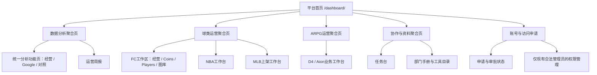

> **2026-10-06当前合同（优先于本文历史段落）：** 首批干净源码已入私库 main bc3b29531cec2fab3fc090385f3d7d126eb9ada7。本批只增加文档与已独立复核 NBA receipts 候选；未提交、推送或部署。FC使用既有全局登录与角色，旧FC-only独立资格/fallback已被最新用户决定退役；当前已观察全局门户策略4管理员为wulv/chenchao/DY/fstech，来源为统一auth独立审阅及policy SHA b02e38348212c82879859cfd5db3c13c1e7506c33515c9e018b6290616f62017，不是本次新增账号。仓库旧C3政策/部分模块仍有三管理员代码，未随本批改动，禁止部署它覆盖四管理员现场。NBA api_security.js仍保留原三管理员模块守卫，其真实代理/角色适配未验，不因此擅授fstech NBA写权限。D4/PoE2/Aion2归陈超；球类归吴律；共享入口吴律主导陈超协作；其它owner待定。NBA R3-01/R3-02只在指定候选/合成证据层关闭，真实运行未验，releaseReady=false。D4/UI/auth源码均不在本批。文中旧权限、未push、FC专用桥与readiness状态是历史依据，不能作为当前发布指令。自助注册默认介绍/申请的业务方向已批准，实际入口/审批未实现。

# 平台产品改造补充草案

项目：MMOEXP 游戏运营Agent  
记录时间：2026-10-05 16:23:06 UTC  
状态：**产品与交互规划草案，未实施、未发布**。本文件补充《当前架构评估与模块化改造方案》，不重写该报告或其Library版本，不改变冻结候选。

## 1. 建议阶段与当前决定

建议将代码基线工作与产品改造分成独立工作线，可使用多个对话并行推进。首批代码审查、准确文件清单和入库准备按既有边界继续；产品改造另立后续增量，信息架构、统一分析页、首页/模块聚合页和注册审批可以在文件范围清晰时并行设计。每项按自身依赖和验收门槛试点，不要求全平台串行重做。不能让“更专业的首页”演变成首次入库前必须重写全站的无限前置条件。

首次Git push仍未获批准，本草案不代替该批准；建立私库、已有write成员、代码审查、首次push和生产发布是不同状态。已识别的敏感物/候选范围/运行缺口照常记录，不能因先入库而声称生产可用，也不能把后续UI愿景倒灌为首版必须全部完成的要求。

| 事项 | 当前状态 | 本草案如何处理 |
| --- | --- | --- |
| Google与经营在全局看板同页切换内容分类 | 用户明确提出的新产品目标 | 设计统一分析功能页，保留各自来源与权限；不是合并底层财务口径 |
| 首页更专业，模块分区、有不同交互页面 | 用户明确提出 | 首页→模块子聚合→具体功能三级结构；不是页内锚点或一页堆满所有功能 |
| 完善角色、自助注册、权限管理供同事试用 | 用户重新明确提出，取代此前取消该方向的要求 | 恢复为规划事项；尚未开放注册、创建账户或改变生产权限 |
| 已授权FC同事读全部FC经营数据，敏感写仅admin | 已批准业务范围 | 延续已有FC备忘，不能因为新增注册流程而撤回其既有合法权限 |
| 新注册用户默认权限 | **已确认业务范围** | 新注册账号默认仅平台介绍/申请权限，审批后再开放经营数据；尚未配置或上线，不套用已授权FC同事现有范围 |
| NBA自动运行 | 方向认可、升级后置；当前先稳定、简单可用 | 不纳入本次UI试点必做项，不新增生产自动化 |
| 代码/生产/账号/权限/Ponytail/Library正式报告 | 本次不变 | 仅追加本地规划和决策登记 |

本草案中的新路径、角色状态、页面字段和试点门槛均是设计建议，除上表明确业务决定外，不表示已经实现或获实施批准。完整待确认事项由根协调一次只问一项，本任务不另向用户并行提问；逐项沟通不等于限制独立工作并行。

新增确认依据：用户消息`Sentinel_3680410afff48191a41738abefe34b05`回答“可以”，确认新注册账号默认仅平台介绍/申请权限，审批后再开放经营数据。此前“建议、待答”状态被本次业务确认取代，实际身份与权限实现仍不在本轮。

## 2. 实际基线与设计依据

实际工程根目录为 `E:\WorkBuddy\大超服务器`。下表C3指根目录下 `fs_platform_integration_20261005/candidate_revision3`；本轮只读代表源码，没有执行候选。

| 已见事实 | 实际依据 | 对产品设计的约束 |
| --- | --- | --- |
| 首页已有全站经营、Google、任务台、周报卡片；工具另列Coins/Players/MLB/NBA/D4等 | C3/`fs_home_live_20260930/module-registry.json` | 现有能力不能在导航整理时丢失；迁移的是信息层级，不是删除功能 |
| 首页app另有硬编码模块白名单，registry ownerId尚为null | 同目录 `app.js:18`、registry | 新聚合入口必须同时验证渲染与路由；维护人展示依据已确认分工，不按null或目录名猜人 |
| 首页与完整经营页是不同路由 | `/dashboard/`、`/dashboard/index.html`，原架构报告与既有发布合同 | 不因“统一分析”把首页重新覆盖成经营HTML；经营v7走原受控发布网关 |
| Google UI按品牌、来源、自然周展示；来源覆盖单独显示 | C3/`mmoexp_google_data/dashboard_module/marketing-module.js:18,25` | 统一页也必须保留GA4/GSC/Ads差异与实际覆盖，不套一个全球“最新数据”时间 |
| Google每天09上海采集，页面300秒检查；经营标签60秒独立检查 | 同上`:25,30`，`business-module.js:119` | 同页刷新不意味着采集节奏合并，不新增采集器或提高生产频率 |
| 营销业务对照已经只读经营不可变快照、校验schema/manifest/SHA | `business-module.js:34,57` | 可以复用已有合同与纯渲染逻辑，不能重新复制订单采集 |
| Google源码已明确GA4新用户、购买事件/收入不等于经营新客/销售 | `marketing-module.js:18,25` | 产品文案与汇总逻辑必须继续清楚区分，不展示伪合并财务指标 |
| 门户当前是内部组/会话验证，FC独立身份域另有边界 | C3/`opt/auth-portal/auth_portal.py`及原架构报告第6节 | 不能把“自助注册”直接实现为写入dashboard组，不能以用户名相同继承内部权限 |

已确认负责人：吴律负责球类（FC/NBA/MLB及既有其它球类范围）；陈超负责D4/Aion；登录、首页、导航由吴律主导发布，陈超可参与特殊迭代设计，共享变更需协调，不是排他权限。经营供数、Google等未明确归属，不在本草案代为分配。

## 3. 信息架构：首页→模块聚合→功能页

### 3.1 三级职责

| 层级 | 页面应回答的问题 | 内容与交互 | 不承载的内容 |
| --- | --- | --- | --- |
| L1 平台首页 | 我能进入哪些工作区、现在有什么需关注 | 授权范围内的概览、模块入口、最近访问、明确的数据/服务状态；完整页面跳转 | 全量经营图表、所有工具参数、直接批量改价/上架 |
| L2 模块聚合页 | 这个业务域有哪些能力、我应去哪里 | 模块说明、已有功能入口、受限操作提示、维护责任、状态；按任务类型分组 | 把所有子系统嵌入同一大页、用锚点假装模块切换 |
| L3 功能页/面板 | 我如何完成一个具体任务 | 分析/筛选/计划/审核/执行等专门交互，面包屑返回聚合页 | 与当前任务无关的全站配置或其它模块后台 |

首页顶部全局导航指向真实模块聚合路由，浏览器前进/后退、刷新、复制链接都应落到相同页面。功能页内部可以使用tab或筛选切换，但不能拿首页的滚动锚点代替模块页面。一个页面是否独立以URL、权限合同、加载入口和任务目标判断，不要求为了不同视觉布局新增后端服务。



图是导航建议，不是权限继承图。进入“球类聚合”不自动获得全部球类数据；进入“分析聚合”不自动获得Google/全站数据。聚合页按已授权范围展示可进入能力；新注册账号默认仅平台介绍和权限申请，不展示经营数值，审批后才按批准范围开放。具体介绍页面、申请入口和服务器授权实现尚未发布。

### 3.2 首页与聚合页的产品形态

首页建议以“工作入口+授权范围内摘要”为核心：顶部统一品牌、当前账号/范围、全局导航；正文按数据分析、球类运营、ARPG运营、协作四区组织；每区只有少量主入口与可理解的状态。不要在首页展示没有权限访问的数据摘要，也不要为追求视觉丰富加载全部后台。

“更专业”具体化为一致的标题/间距/配色/状态语义、明确的主操作、可读表格、键盘焦点、窄屏布局与真实错误态。正常、过期、等待、失败、未授权各有不同文字和表现，颜色只是辅助。没有数据时保留布局和解释，不用虚构示例数值填充真实页面。

不同模块保留适合任务的交互：分析页以筛选/图表/明细为主；Coins/NBA以来源、建议价格、计划和回执为主；Players/MLB以列表选择、校验、计划预览为主；任务台以项目/任务状态为主。统一的是导航和基础视觉，不把所有业务改造成同一张卡片模板。

低频管理、部署入口保持独立且限权，不占普通用户首页主操作。共享导航不得注入可执行业务写命令，点击卡片仅导航，不触发采集、刷新后台、改价或上架。

## 4. 统一分析页：同页切换，不强行合并数据

### 4.1 页面状态与切换

目标是在同一个全局分析功能页内切换“经营分析”“Google运营”“经营与营销对照”，并在各模式内选择内容分类。建议最终沿用 `/dashboard/index.html` 作为统一分析功能入口；但在试点完成前不替换经营v7，先在明确标记的独立试点页面验证。现有Google独立页在过渡期保留。

| 状态层 | 建议状态 | 行为 |
| --- | --- | --- |
| 功能模式 | business / google / compare | 页面不整站跳转；切换相应渲染模块，仅请求有权限且当前需要的数据 |
| 业务范围 | all-sites / 已授权业务或游戏；Google品牌/账号范围另列 | 不能把某游戏筛选自动映射到无游戏维度的Google账号；不支持时明确提示 |
| 内容分类 | 经营指标/趋势/结构/商品；Google GA4/GSC/Ads/已有细分 | 分类与来源匹配，不提供没有真实接口支持的“任意组合” |
| 时间 | 业务日期区间/小时或自然周；Google已支持完整自然周/实际来源日期 | 共同日期是查询意图，各来源覆盖单独校验；不支持的时间粒度显示原因，不静默改日期 |
| 展示 | 图表/明细、排序、已支持维度 | 纯展示状态不得改变统计口径；返回、刷新和复制链接可恢复 |

建议用查询参数表达非敏感页面状态，例如`mode`、`scope`、`period`、`category`。这些参数仅是视图请求，服务器必须再次验证身份、范围和允许枚举；URL不含token、会话、账号秘密或原始订单。非法组合要返回明确提示/安全默认视图，不能借参数读取任意profile。

切换时取消已失效请求，响应按模式/范围/日期/来源版本核对后渲染，避免先发慢请求覆盖后来选择。离开某模式停止其非必要轮询；回到页面按该来源原有检查周期更新，不因tab每点一次就启动生产采集。对照模式独立展示两侧状态，一方失败不清空另一方有效数据。

### 4.2 来源、时效与统计口径合同

| 数据 | 当前合同/时效 | 统一页必须保留 |
| --- | --- | --- |
| 经营销售/订单及四核心 | Order主源，Admin补缺；fs120每120分钟，前端每60秒检查 | all-sites口径、USD、上海时区、不可变snapshotId/SHA；准确区间用原生聚合，不按日加人数/利润率 |
| FC经营/商品榜 | 已批准FC同事读全部FC经营类别；产品榜原生9627/9629/9625 | FC限定投影与授权边界；不能将原始订单/其它游戏打包到浏览器后靠隐藏实现隔离 |
| Google | 每日上海09采集，UI300秒检查；GA4/GSC/Ads来源覆盖不同 | 每来源`data_generated_at/latestDate/coverage/status`及品牌、property/账号范围，不统一伪称“实时” |
| 营销中的经营对照 | 当前60秒检查统一经营快照 | 经营版本与Google版本分别列示，不复制第二套经营采集 |
| 周报 | 完整上海自然周，Mon02作业；人工补跑单独标识 | 自然/人工、周期完整性与批准项目范围，不能靠页面合并扩大Aion2周报范围 |

统一页顶部可显示“当前所选期间”，但每个来源卡片都要显示自己的“覆盖至何时、何时生成、是否完整”。不能取两边较新的时间作为整页更新时间；Google延迟不表示fs120失败，fs120新快照也不使Google变新。

对照模式只并列可比较且定义明确的指标。经营新客不是GA4 newUsers；经营销售不是GA4 purchaseRevenue或Ads归因价值；广告账号间、品牌间和全站经营范围不默认相同。没有核实币种、归因窗口、时区、日期与覆盖范围时，不计算跨源ROI/ROAS/用户转化率或因果结论。已有Ads来源原生ROAS可按其原定义展示并标注，不改称全站经营利润回报。

金额、数量、比例、去重人数分别遵守原合同；禁止把分项目利润率、日人数、品牌用户直接相加。Aion2经营Order826/Admin891与D4/Aion竞价数据继续隔离。Google数据可同页呈现，不代表向FC-only自动授予Google数据访问。

### 4.3 统一页的权限与历史数据风险

对已有全站授权用户，可以在后端确认范围后提供其经营/Google视图；对FC-only，统一壳若开放给其使用，只能消费批准的FC专用snapshot/range投影，没有相应授权的模式不加载数据。不能将当前含私有历史PROFIT的全站v7完整HTML直接交给FC-only再隐藏其它项目。

因此统一UI不等于同一份含全量数据的HTML，也不等于全角色共用一个宽权限API。试点可先只面向已有合法全站账号；FC同事仍使用原FC工作台，待限定投影与页面端到端通过后再接入共同壳。接入不会撤销其原合法权限，也不会扩大到其它业务。

## 5. 路由、模块边界与独立部署兼容

以下新路径均为建议，未创建或配置；最终须核对真实Nginx、已有路由和权限合同。

| 层级/功能 | 建议路径或保留入口 | 部署边界 |
| --- | --- | --- |
| 平台首页 | 保留`/dashboard/` | home静态产物；不重启业务worker |
| 数据分析聚合 | 建议`/dashboard/analysis/` | 新静态聚合页；经已批准认证范围访问 |
| 统一分析试点 | 建议`/dashboard/analysis/preview/` | 独立试点产物，明确非生产替换；实际启用需另批 |
| 统一分析正式功能页 | 最终保留`/dashboard/index.html?mode=...` | 通过经营受控网关发布，保持14指标/三图/准确区间等既有回归 |
| Google旧入口 | 过渡期保留`/dashboard/marketing/` | Google产物与采集不因UI壳上线而整体重启；后续是否跳转另审 |
| 球类聚合 | 建议`/dashboard/sports/` | 授权能力目录；子入口指向FC/NBA/MLB现路径 |
| ARPG聚合 | 建议`/dashboard/arpg/` | 指向现`/d4/`及核实后的子功能，不新建Aion经营采集 |
| 协作聚合 | 建议`/dashboard/work/` | 指向`/dashboard/tasks/`、`/docs/`、工具目录等 |
| FC/NBA/MLB具体功能 | 保留`/s/wulv/fc27-ops/`、Coins、Players、`/nba2k27/`、`/mlb/` | 原服务/端口/状态所有权保持，导航升级不触发写入 |
| 注册申请/权限管理 | 路径待注册方案和有效门户路由核对 | 身份基础模块单独版本与验收，不随home UI默认启用 |

统一分析页以“页面壳+按需加载的独立渲染模块+版本化数据合同”实现，不把Google collector和经营collector合成一个进程。现Google `fetch('./data.json')`在移动页面后会改变解析路径，后续应注入明确数据端点而不是照搬脚本；60/300秒轮询也应由模块生命周期管理，避免页面同时运行多份重复timer。

主题、导航和筛选控件共享纯代码源，构建时固定版本进入各模块产物；不运行时覆盖一个全站可变JS文件。每个页面明确依赖的UI版本和API/schema版本，保留旧版本兼容期。一次导航变更不要求全站所有模块同日重发。

新路由单独验证尾斜杠、相对资源、历史链接、浏览器返回、登录next路径和授权失败。Nginx旧URL保留，模块API前缀保持；普通模块发布不修改全站配置。真实身份由服务器验证，隐藏入口只改善体验，不能替代后端授权。登录next仅允许已验证站内路由，避免把注册/登录改造变成任意跳转入口。

## 6. 自助注册、申请、审批与审计

### 6.1 先区分人群，不能把既有权限清零

| 人群 | 已有/建议访问边界 | 状态 |
| --- | --- | --- |
| 已授权FC同事 | 登录后可看全部FC经营数据类别；敏感写仅admin；其它原合法授权保持 | 业务范围已批准，技术接入仍需验收 |
| 已有其它合法内部用户 | 沿用其原模块范围 | 不因新注册流程强制回到“待审批”或批量撤权 |
| 新注册、未审批用户 | 默认仅平台介绍/申请权限，经营数据须审批后开放；审批状态展示为建议交互 | **业务范围已确认，实际配置和实现未执行** |
| 新注册、已审批用户 | 仅获明确批准模块/范围，批准FC后适用FC已批准读范围 | 具体审批规则与实施待定，注册本身不是授权 |
| 管理员 | 沿用现有合法管理员及具体模块守卫 | 不新增第四admin，不因审批页面存在授予新管理员 |
| 匿名访客 | 现有门禁保持 | 未来注册页/申请说明如何公开尚待设计批准，本轮不新开匿名入口 |

“重新提出自助注册”是恢复产品方向，不是“所有注册成功者立即进入dashboard组”。建议注册记录先与业务授权分离，未审批记录不能被现有`DEFAULT_GROUP`、同名匹配或前端状态转换自动赋予权限；具体实现必须核对门户与FC gate各自账户模型，不能直接写现有凭据文件当快捷实现。

### 6.2 建议流程与状态机

```text
提交注册/试用申请
  → 待验证（验证渠道待定，不能假设已有邮箱/短信服务）
  → 待审批
  → 批准指定模块与访问范围 / 拒绝并说明 / 退回补充
  → 已生效授权
  → 到期、暂停或撤销（若采用有效期机制，规则需批准）
```

上述流程为设计，不创建邮箱服务、账户或凭据。申请页仅收完成身份核实和业务范围所需的信息：拟用身份、团队/用途、申请模块、必要说明；不要求上传凭据、订单或敏感客户资料。如何证明是同事、是否采用邀请链接/既有公司身份/人工核验，均由现有能力与用户选择决定。

审批者仅能批准其被正式授权的范围；业务负责人不自动等于系统权限管理员。吴律/陈超的模块维护分工不能直接转换为审批权限。首次试用可建议由现有合法管理员处理申请，具体审批人和能授予的范围仍待确认。自助申请不得选择并自动获得admin，不得通过同名账号继承现有admin或FC权限。

审批动作要绑定申请ID、目标身份、模块范围、操作类型、必要的有效期与授权版本；重复提交不重复赋权，并发审批按当前状态/版本检查；撤销和重新申请保留历史，不能覆盖原审计。是否允许同人申请并自批需明确定义，不能无意产生自升权入口。

用户应能看到本人申请状态、当前已批准模块和拒绝/补充说明；管理员看到其审批范围内的队列与差异预览。对已授权用户，新增模块申请是增量，不重建账户或覆盖全部现有组。撤销某一模块时只撤其明确授权，不顺带撤销其它合法模块。

### 6.3 审计与安全验收边界

记录申请/审批/拒绝/生效/撤销事件的事件ID、时间、操作者、目标账号标识、前后授权差异、范围、理由和关联请求。审计不记录密码、token、Cookie或验证秘密；审计读权限与权限管理写权限分别约束。保留期、试用到期和清理规则待决定，不自动建清理timer。

未来实现需要验证注册滥用限制、重复身份、异常状态、CSRF、伪造身份头、未审批用户直接调用API、管理员操作确认、会话过期/撤权后的访问和申请人越权读取他人记录。服务端权限必须覆盖数据、下载、回执、申请查询及所有敏感写端点；只保护菜单不足。发生错误保持原合法授权和明确失败状态，不批量清组“重试”。

新增注册流程必须单独评审与发布。首页上的“申请试用”按钮在流程批准并通过验收前不连接真实开放注册；原有账户和模块继续使用现有访问方式。Ponytail不属于该流程改造范围。

## 7. 渐进试点与验收

| 阶段 | 产物 | 验收与回滚边界 |
| --- | --- | --- |
| A 产品合同整理 | 页面地图、各类用户可见范围、统一分析字段/时效表、已确认新注册默认范围 | 不改生产；记录已确认默认范围，其余问题由根逐项提出；形成并行工作所需的最小共享合同 |
| B 只读统一分析试点 | 经营/Google/对照三种模式的独立试点页；使用现有受控只读数据合同 | 先已有合法账号范围；同页切换/状态保持/来源差异/权限测试；失败撤掉试点入口，不改fs120或Google采集 |
| C 首页与聚合导航 | 专业化home及分析/球类/ARPG/协作子聚合页 | 全部现有入口可达、无死链、无误触写；旧路径仍可用；只回滚home/聚合产物 |
| D 统一分析正式接入 | 在批准范围内将通过试点的UI接入原经营入口 | 原v7受控发布、14指标/三图/准确区间/原生FC产品榜回归；Google独立页保留过渡期；模块数据源不合并 |
| E 注册申请与权限管理试点 | 按已确认默认范围及后续获批审批规则实现申请/审批/审计 | 先指定小范围同事试用；新老用户矩阵、撤权/重复审批/审计验证；停用新申请入口可回退，不能删除已生效授权/审计 |
| F 扩大试用与体验迭代 | 基于真实使用反馈调整信息层级和交互 | 新需求独立评审，不顺手加入NBA自动升级、价格规则或无关模块重写 |

上述编号是交付分组，不是要求所有任务串行。B统一分析、C首页聚合、E注册流程的设计与隔离实现可以并行；D正式接入依赖B对应试点验收，E生产启用依赖其自身审批/身份合同与安全验收，共享路由或认证文件有冲突时再安排明确写入顺序。接口需求和Git流程由其它任务独立推进，本任务仅维护本产品规划文档。

建议验收标准（待负责人最终确认，不是已实现结果）：

- 常用已有功能从首页最多三次明确导航到达；模块入口为真实URL，复制链接/刷新/返回能恢复预期页面。
- 首页、聚合页和试点页键盘可操作，窄屏无重要操作被遮挡；错误/等待/无权/过期文案可区分。
- 经营/Google同页切换不丢当前有效选择；不支持的筛选组合明确说明，旧响应不覆盖新选择。
- 一来源失败时另一来源的已验证数据仍可见，分别显示来源时间与失败状态；无伪合计、伪实时或未授权数据请求。
- FC-only的网络响应与页面源码均不含其它业务数据；Google页签不因在同一壳内自动向FC-only放行。
- 已有同事权限在注册流程上线前后保持；新注册默认仅平台介绍/申请权限的已确认业务范围，须经实现与验证后才生效，未经审批的经营数据访问必须拒绝。
- 注册重复申请/并发审批/撤权/过期会话/越权请求均有确定结果与审计，不新增账户或角色来假装通过真实角色测试。
- 导航或统一分析发布期间，FC/NBA/MLB/D4等业务worker不重启，fs120/Google/周报频率不变，旧dashboard链保持退役。

试点规模、试用名单、验收负责人、是否使用真实已有会话和生产试点路径须在执行任务中明确；本草案不自动安排试用或向同事发送邀请。

## 8. 与代码审查、首批入库及后续版本的关系

首版基线应记录“当前有什么、哪些已验、哪些待验”，不要为呈现愿景而把尚未实现的聚合页/注册功能标为可用。311文件冻结候选保持；本草案作为后续产品需求，不要求重开并修改该冻结集合。

建议分开维护三个状态：

1. **代码审查状态**：准确源码/依赖与敏感物边界、已知缺陷和复审结论；本次产品草案不抹去既有安全门槛。
2. **入库状态**：用户批准的准确首批文件、清洁历史和仓库操作；首次push未批准，不执行。是否将本草案纳入之后的文档提交也按该次准确清单决定。
3. **产品发布状态**：页面、权限、数据合同与真实运行验收；入库不等于部署，不因首版push而开放注册或发布新首页。

后续按独立增量交付：导航/聚合、统一分析、注册审批分别有源码范围、负责人、测试和回滚，可以在多个对话中并行；共享导航/登录由吴律主导协调发布，陈超可参与迭代设计。并行不等于同时覆盖共享文件或绕过生产协调。Google和经营供数责任未明确时，不能让UI改造任务代替其owner决定数据合同。

NBA当前稳定性工作若另获授权，可作为独立修补任务，不等待全站设计；NBA自动策略升级仍后置。本草案不以“简单可用”放松unknown写结果和既有授权守卫。

## 9. 待确认队列（由根协调一次一项）

| 顺序建议 | 待确认事项 | 当前建议/限制 |
| --- | --- | --- |
| 已确认，不再重复询问 | 新注册默认权限仅平台介绍/申请，审批后才看经营数据 | 用户已答“可以”；具体身份权限实现仍待后续任务 |
| 随后 | 一级模块分区与首页主入口是否采用分析/球类/ARPG/协作 | 本草案建议，现有功能入口全部保留 |
| 随后 | 统一分析首批分类和Google范围 | 先复用已有经营+GA4/GSC/Ads/原细分，不扩采集账号/归因口径 |
| 随后 | 试用身份核实方式、审批人及其可授予范围 | 不把业务owner自动当审批管理员，不引入新凭据渠道 |
| 随后 | 首批试用同事和成功标准 | 小范围、已有能力优先；不自动发送邀请 |
| 独立进行 | 首次Git push的准确文件清单与批准 | 与全部UI重写解耦；当前未获批准 |

此表是提问顺序与状态清单，不是同时提交给用户的多题问卷；不得用用户对FC读范围、NBA方向或新注册默认范围的“可以”补齐其它未答事项。独立任务仍可并行推进不依赖答案的部分。

## 10. 本次记录范围

本次只编写本补充草案、追加唯一决策册及交接索引。原架构报告、Library正式版本、冻结候选、源码、账号/权限/凭据、Ponytail、生产路由、调度、部署和Git均未修改。自助注册新方向已登记为规划需求，此前取消记录保留历史，不能再用旧取消决定否定本次新要求；也不能用新要求声称已开放注册。
