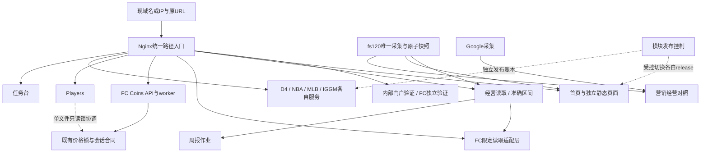

> **2026-10-06当前合同（优先于本文历史段落）：** 首批干净源码已入私库 main bc3b29531cec2fab3fc090385f3d7d126eb9ada7。本批只增加文档与已独立复核 NBA receipts 候选；未提交、推送或部署。FC使用既有全局登录与角色，旧FC-only独立资格/fallback已被最新用户决定退役；当前已观察全局门户策略4管理员为wulv/chenchao/DY/fstech，来源为统一auth独立审阅及policy SHA b02e38348212c82879859cfd5db3c13c1e7506c33515c9e018b6290616f62017，不是本次新增账号。仓库旧C3政策/部分模块仍有三管理员代码，未随本批改动，禁止部署它覆盖四管理员现场。NBA api_security.js仍保留原三管理员模块守卫，其真实代理/角色适配未验，不因此擅授fstech NBA写权限。D4/PoE2/Aion2归陈超；球类归吴律；共享入口吴律主导陈超协作；其它owner待定。NBA R3-01/R3-02只在指定候选/合成证据层关闭，真实运行未验，releaseReady=false。D4/UI/auth源码均不在本批。文中旧权限、未push、FC专用桥与readiness状态是历史依据，不能作为当前发布指令。自助注册默认介绍/申请的业务方向已批准，实际入口/审批未实现。

# 当前架构评估与模块化改造方案

项目：MMOEXP 游戏运营Agent（本机工程实际目录：`E:\WorkBuddy\大超服务器`）  
版本：规划评审稿 1.0｜2026-10-05｜仅评估设计，未实施  
依据：revision3 冻结候选、实际代表源码、归档部署声明、最新两份独立复审及已归档生产验收。

## 1. 结论与边界

建议采用**单仓管理、模块独立产物与运行环境、现有 Nginx 统一路径入口、模块独立状态与发布账本**。先治理现有进程和数据边界，再小步整理代码。当前已经有多个 Python/Node 服务、systemd 定时器和部分 Docker 容器，不需要把所有模块重写成微服务，也不需要新增 Kubernetes、消息中间件或第二套全站采集。

实现目标的关键不是多建目录，而是让每个模块有确定的源码清单、进程、运行环境、唯一写入者、数据目录、接口契约和发布负责人。普通业务模块的部署、重启、代码回滚不得重启其它模块或覆盖其它模块的数据库、配置、静态文件。共享认证、Nginx、宿主机、Docker daemon 和经营供数仍是共同依赖；本方案减少它们的变更频率与故障传播，不承诺单机架构下完全消除共同故障。

本轮实际只运行自己编写的标准库静态盘点脚本，读取文本、AST、文件大小和 SHA；未 import、执行、安装候选或原包代码，未访问生产、真实账户、订单、数据库、会话或密钥；未改价格、Ponytail、权限、定时任务、Git、冻结候选。报告不含真实经营数值、原始订单、Cookie、密码、密钥或带秘密的完整配置。

必须保持的现状：

- `fs120` 经营供数正常；旧 `dashboard-pipeline` / `dashboard-fallback` / 旧 publisher 已主动退役。归档中仍有其文件不构成恢复理由。
- `/dashboard/` 是首页入口，`/dashboard/index.html` 是经营 v7 完整页；保留 14 指标、三图、准确区间、等待/失败/缺失态和现有返回入口。
- 经营 Order 主源、Admin 补缺和系统间不同游戏/分类 ID 保持。Aion2 经营使用 Order 826 / Admin 891；D4 下的 Aion2 竞价、成本、通知是另一业务域。
- FC Players / Packs / SBC 销量榜走原生 API 子类 9627 / 9629 / 9625；不改成商品静态表估算。Coins 既有 15 档、rev25 四档降幅、赠送成本及 Xbox 独立成本护栏保留，不恢复已移除 20/30/40K。
- 三管理员仍为 wulv、chenchao、DY；不新增 fstech，不把 FC 外部同名用户升级成内部身份。Ponytail 配置不动。
- revision3 仍为 `releaseReady=false`、`uploadApproved=false`；本方案不是生产放行单，也不授权候选源码上传。

## 2. 证据、机器与可信范围

### 2.1 实际位置与取证口径

用户描述中的 `E:\WorkBuddy\大超服务器项目` 不存在；通过本机目录和证据索引核实，实际根目录为 `E:\WorkBuddy\大超服务器`，下文简称 **P**。不要根据显示名创建另一个工程副本。

| 标识 | 机器/位置 | 时间与证据级别 | 能证明 / 不能证明 |
| --- | --- | --- | --- |
| E01 | Windows `PC-20260909OJLI`；P 下 `AGENTS.md`、`.gitignore`、`docs/decisions/OPEN-DECISIONS.md` | 本轮阅读，2026-10-05 | 项目约束与记录状态；带日期条目不是实时探测 |
| E02 | P/`docs/planning/fs-platform-integration-20261005/revision3/review-notes/architecture-evidence-index.json` 及 `decision-note.md` | 索引记录 2026-10-05 23:28:44 +08；本轮读取 | 真实路径、候选分类和四共享资源；索引当时“复审进行中”已被 E05/E06 最终报告取代 |
| E03 | P/`fs_platform_integration_20261005/candidate_revision3`，简称 C3 | 本轮 2026-10-05 15:34:44 UTC 独立静态核验 | 311 文件、12,111,256 字节，每文件 SHA/大小及文件集合完全匹配；不证明运行通过 |
| E04 | P/`fs_platform_integration_20261005/data/raw/chenchao-source/fs-platform-src`，简称 R | 本轮枚举 778 文件；内容是归档快照 | 原包结构、代表源/配置声明；不是当前有效 Linux 配置。原包有敏感字段，禁止整体上传 |
| E05 | `D:\codex\2026-10-05\task-5\revision3-independent-security-review.md` | 2026-10-05 最终有限安全复审 | 原三 P1 指定机制修复，无新已证实 P1；保留两个 P2、真实运行与角色未验 |
| E06 | `D:\codex\2026-10-05\task-6\fs-revision3-final-review.md` | 2026-10-05 最终有限功能复审 | R2-F1～F3 静态源码/主任务合成记录层关闭；不是端到端或部署验收 |
| E07 | P/`docs/planning/fs-legacy-retirement-restoration-20261005/natural-acceptance.md` | 2026-10-05 15:19:13–15:25:05 +08 自然周期；后续首页回查 | 已归档 fs120 自然成功、v7与首页保持、旧链退役证据；本轮未再登录生产 |
| E08 | P/`docs/planning/mmoexp-weekly-range-parser-fix-20261005/approved-release.md` 与当前 range 源 | 已归档 2026-10-05 上线/人工补跑；本轮核源码 SHA | 活动 range 是 0a03f802…；人工补跑不是下次自然成功 |
| E09 | P/`docs/planning/fs-platform-integration-20261005/architecture-inputs-static.json` | 早期 227 候选阶段的96代码记录、101 Nginx 指令、50 unit 声明 | 历史定位辅助；旧“缺源码”结论须以 C3 实查更新 |
| E10 | 本方案同目录 `architecture-static-verification.json`、`inspect_architecture.py` | 本轮标准库脚本产物 | 311准确库存、代表依赖/表定义、归档 unit 哈希/声明；无生产操作 |

C3 清单文件 SHA：`196e4789ba19364d047adb3f9a5ee915cd354b2022cacf2de964a721bc25a41c`。清单声明集合摘要为 `f1d7ce1d3cb2c73ccaae58744ef2ff2a34cef69070d098193b2cac86b7ae532c`；本轮逐文件核验，没有自行假设集合摘要序列化算法。原 171/227/301 文件版本仅用于追溯；C3 不能反向覆盖它们。

原包“17模块”是历史入口分类，不是17个独立部署单元。原包 `opt` 有21个子目录，包含历史发布任务；补充索引按17组分类 C3 的232个模块文件，另有79个支撑文件。三个数字口径不同。C3 内任务台真实路径为 `opt/mmoexp-taskboard/` 四文件；旧 runtime map 的 `taskboard_module_20261001`/0计数是索引错误，不能认定源码缺失。

### 2.2 最新 review 的准确使用

| 项目 | 可采纳结论 | 方案必须补齐的门槛 |
| --- | --- | --- |
| FC 会话 | C3 限定 GET/HEAD 和 FC 路径，独立 `X-Fc27-*`，不再扩大内部组 | 四静态资源和准确区间数据完整兼容、真实 Nginx 原 URI/方法传递及四类角色 |
| NBA 并发 | 独立计划传输文件、哈希/操作者/ID回执绑定、生命周期锁已静态修复 | 正常 UI 未传 requestId、成功响应未返回绑定身份、错误丢 detail；未知结果无法完整核对 |
| NBA 耐久 | 文件 fsync 后原子替换；已有 pending 拒绝重放 | 目录 fsync 与新目录父目录同步缺口；未做 Linux 多进程/掉电验收，不宣称已发生重复写 |
| 静态包 | JSON 递归凭据识别、重复键/非法内容、ZIP 全量先验和生成策略一致性有改善 | HTML/JS 扫描仍是启发式；不能当任意同源脚本沙箱或“绝无秘密”保证 |
| FC 迁移 | 六后台实际身份、15档 Decimal 有限正值/数值唯一、真实 Python/JS 四档和 write gate 矩阵补齐 | 当时真实六后台、三公开页、外置策略修订与运行映射仍需验收 |

主任务归档：47项 Python（46通过、1 Windows symlink skip）、3组 Node；静态182 Python AST与34 JS语法记录。独立 reviewer 没有重跑候选测试；revision3 未重跑 revision2 完整170项，也没有独立 raw test-evidence 子目录。不得相加成“217项新版全套通过”，不得将 AST 可解析称为已执行成功。

## 3. 当前结构、功能与运行依赖评估

### 3.1 模块现状与改造取舍

下表源码均相对 C3；运行路径和端口来自归档声明/已有验收资料，**不是本轮现场进程确认**。

| 业务边界 | 代表源码、已见结构与依赖 | 运行/数据关联 | 建议归属与拆分判断 |
| --- | --- | --- | --- |
| 首页与导航 | `fs_home_live_20260930/{app.js,module-registry.json,index.html}`；registry与硬编码白名单共同决定入口 | `/dashboard/`、`/var/www/dashboard/fs-home`；只读经营快照 | 独立静态模块；入口展示不拥有业务权限或写数据能力；registry与白名单先同包验证，再改为单源生成 |
| 经营展示 | `共享资源/MMOEXP统一看板/dashboard.template.html`；v7是私有历史数据与模板双SHA重建 | `/dashboard/index.html`；受控 release gateway及七依赖 | 与首页分开发布；模板不能直接替代完整HTML；不将私有 PROFIT JSON入仓 |
| 经营供数 fs120 | `fs_transaction_snapshot_20260930/{collector,atomic_snapshot,primary_reader,supplement_reader,fc_*}.py`；collector调用现有容器reader | 120min timer，不可变 snapshot/current pointer；Order/Admin会话留原容器 | 一个业务数据模块，采集与只读服务是不同进程；唯一快照写入者。不能按每个游戏重建十套采集器 |
| 准确区间 | 当前 `mmoexp_google_data/weekly_report/range_parser_release_20261005/source/range_api.py`；直接sys.path引入`/opt/fs-transaction-snapshot`，复用collector/reader | 8931，range缓存，单worker线程池；周报/经营/FC消费者 | 与经营同数据所有者，独立进程和缓存；先把纯合同与reader调用封装为固定版本依赖，避免路径导入当前可变目录 |
| FC运营只读 | `fc27_ops_cloud/index.html`及`data`下7前端源；四跨模块静态URL和内部range硬编码 | `/s/wulv/fc27-ops/`，旧ops API 8899外置；现数据来自统一快照 | 独立展示模块；消费限定FC数据投影；不恢复旧ops采集器替代fs120 |
| FC Coins | `fc27_cloud_browser`队列/API/worker/writer/automation，根报价引擎与Chrome JS | API8879、报价8877、活动8878、会话8767、CDP；锁/队列/策略外置 | 一个业务模块，API/worker/browser/session为内部运行组件；报价、守卫、写执行不能拆成无合同的独立产品 |
| FC Players | `fc27_players_cloud/player_web`＋`球员维护工具`；cloud.9，45源+manifest | 8901容器、SQLite计划/执行/审计；读Coins单一价格锁 | 独立模块；新卡、模型、图片同一计划生命周期；不与Coins合库，不复制/删除共享锁 |
| Google营销 | `mmoexp_google_data/implementation`、`details`、`dashboard_module` | 每日09上海采集，UI300秒；业务对照只读统一快照 | 独立采集/展示模块；OAuth留原受控路径，不拥有经营采集器 |
| 运营周报 | `weekly_report/{run_weekly_exact,range_adapter,weekly_report}.py`与JS | 周一02上海；通过8931准确区间；归档ExecStart借用营销`venv-ssl` | 独立作业/产物模块；先脱离营销解释器。保留九项目范围，Aion2独立周报范围另待决 |
| 项目任务台 | `opt/mmoexp-taskboard/taskboard_server.py`＋web三件套；stdlib+SQLite内联schema | 8932、members/projects/tasks/checks/task_events；三级权限 | 独立模块/库；不得覆盖taskboard.db；模块成员不替代门户全局身份 |
| D4/ARPG跟价 | `opt/d4follow/app.py`本轮3400行；Flask+线程任务/queue，engine/gates/store，多源抓取 | 8900 gunicorn、srv_exec和collect/watch；`iggm_follow.db`多表及可变配置 | 先在同模块内拆route/service/adapter/store，保持现有守卫；Aion2 watch与金币业务同域、不同作业，不并入经营Aion2 |
| NBA改价 | `opt/nba-reprice/backend/server.js`→Python `p2pah_api.py`→`write_contract.py`；OCR子进程 | 8765 Node；独立Python/OCR依赖；仓外NBA_DATA_DIR、receipt/lock | 独立模块；Node/Python/OCR作为一致版本产物，不给其它模块共用写价客户端；人工/无人值守先决策 |
| MLB上架 | `opt/mlb-online/{mlb_server,static_path}.py`＋`var/www/mlb-online/index.html` | 8897；SQLite tasks/agents/kv、上传文件与agent任务 | 独立模块；上架队列/agent协议是部署验收的一部分。进程在线不代表下游执行agent可用 |
| IGGM采集工作台 | `opt/iggm-web/{app,runner,db,sites,core*,url_guard}.py`；Flask，进程内worker/队列 | 8787；SQLite tasks和exports；归档根路径兜底 | 独立模块；不能为横向扩容直接把gunicorn worker从1加多；提交者备注不是可信身份 |
| 内部认证与策略 | `opt/auth-portal`4文件＋`opt/fs-access-policy/access_policy.py` | 8895；内部签名/登记组外置；FC8896为另一身份域 | 共享基础能力，业务授权留模块；三admin源与各消费者通过契约测试防漂移，不建万能写权限角色 |
| 发布能力 | `opt/deploy-hub`3文件；`fs_dashboard_overwrite_20261003/release_gateway.py` | 8898与站点注册/日志；经营网关有SHA/版本/依赖/锁账本 | 静态站点部署hub与经营发布网关保持不同许可范围。只共享校验协议，不让hub获得任意经营覆盖能力 |
| 未纳入完整闭包 | FC gate/activity/Gallery外置；Madden原件/归档unit；docs/hub/fc-odds静态入口；Ponytail | 归档Gallery8902、Madden unit、系统运维agent存在声明 | 保留路径与现有能力；C3未完整覆盖，列入盘点不认定停用、不擅自补装/重启。Ponytail零改动 |

### 3.2 Nginx、systemd、Docker、PM2 的实际证据

- **Nginx有归档配置证据**：R/`etc/nginx/conf.d/iggm-web.conf`，单server及多个include；路由声明已见门户、首页、NBA、FC、D4等。任务台规则必须延续现有幂等补丁工具及`nginx -t`失败还原约定。未读取当前`nginx -T`，故include实际加载、正则优先级、身份头覆盖与TLS现状均未新验。
- **systemd有50份归档unit/timer声明**，其中有云运维agent和已退役旧unit，不能统计为50个活动业务服务。FC API/worker/session、任务台、D4、NBA、MLB、IGGM、fs120/range/Google/周报均有声明。部分User=root或省略User；是隔离风险依据，不是本轮对实际有效UID的判定。
- **Docker确有使用证据**：FC浏览器4个Dockerfile、Players多个历史镜像Dockerfile；归档有效位置unit声明session只读文件系统和回环8767、Players cloud.9只读容器/uid992/CPU内存限额/单文件锁只读bind。collector代码通过`docker exec`使用既有会话容器。镜像tag不等于不可变digest，容器当前bind/镜像SHA未验。
- **PM2未发现受审范围的ecosystem配置或明确运行入口**。NBA已有systemd直接启动Node的声明；不为统一名字再加一层PM2。未查生产进程，不断言整台服务器绝对没有PM2。
- **Docker Compose配置未在R/C3构建文件盘点中发现**；不能称现为Compose全栈部署。未发现本次业务闭包需要Kubernetes、Redis、RabbitMQ或集中MySQL/PostgreSQL的证据，不能按想象补画这些基础设施。
- **依赖未统一锁定**：Players锁有openpyxl 3.1.5、et_xmlfile 2.0.0、Pillow 9.0.1；IGGM为Flask/gunicorn下限，Google为未锁版本；NBA源码使用Node内置模块，但OCR依赖独立Python环境。原模块地图记载CentOS7/glibc2.17、Node特殊构建和numpy兼容约束，属于归档提示，实施前核实。Dockerfile存在继承本地旧tag、构建时下载current Chrome，不能保证空机可重建。

### 3.3 定时与后台作业边界

| 作业 | 已见证据 | 后续规则 |
| --- | --- | --- |
| fs120 | 归档`fs-transaction-collect.timer`=120min；E07自然成功 | 保留单写者与原频率；前端60秒检查是读检查，不是再次采集 |
| Google | `mmoexp-marketing-daily.timer`09:00；项目合同上海时区 | 不因模块化更改采集时刻；UI300秒、经营对照60秒分别记载 |
| 周报 | `mmoexp-weekly-report.timer`Mon02；人工补跑已归档 | 上海自然周、单timer；下次自然验收独立于人工补跑；不扩大Aion2范围 |
| FC | automation-tick/monitor归档1min；activity维护1h；Players采集60min | 每个作业登记拥有者、锁、超时、队列；本轮不变更或确认其有效频率 |
| D4/Aion2 | collect与watch归档均15min；watch注释却称主采集每小时 | 明确证据冲突，待查有效timer；不要据注释改为小时或据旧unit重启作业 |
| NBA | 当前前端含循环和逐次confirm | 不是已实现服务器无人值守；不得为“恢复自动化”加timer或绕过确认 |
| 旧dashboard链 | 归档有12:15/18:15；E07两timer disabled、三service masked、publisher缺失 | 退役状态纳入每次发布不变量，绝不恢复 |

计划登记建议包括timezone、触发类型、是否补跑、maxRuntime、互斥锁、输入时效、上次开始/成功、下次计划和unknown处置。频率与启停属于业务合同，独立于代码升级。

## 4. 主要问题与优先级

| 优先级 | 有依据的问题 | 影响与处理 |
| --- | --- | --- |
| P0级发布门槛（非新P0漏洞） | 冻结源码通过不等于有效身份/unit/容器/路径验收 | 在任何模块生产切换前完成对应运行闭包；C3不能整体上线 |
| 高 | FC外部页面跨取内部四静态资源与全站range接口 | 设计FC专用资源和服务端数据投影；不能扩dashboard权限凑兼容 |
| 高 | NBA UI→后端→receipt身份未闭环、目录耐久缺口 | 先补合同设计和受控验证，再考虑写路径发布；unknown不得新ID盲重试 |
| 高 | 业务服务root/共享写目录/发布hub同源脚本 | 模块写权限、受控产物路径和可信发布者分开；路径划分不是浏览器同源隔离 |
| 高 | range路径import可变collector；周报借营销venv；共享reader/session容器 | 固定版本纯依赖、独立运行环境、共享会话明确容量和访问合同；共享失败显示状态而非错数据 |
| 中 | D4 app中路由、状态、线程任务、配置与业务混合；IGGM线程队列 | 同模块内先分层，再按真实负载决定独立worker；迁移未持久任务先排空/核对 |
| 中 | 公共静态文件可原位替换，版本查询串与实际字节未必一致 | 内容哈希资源、模块pin版本、兼容期保留旧字节；禁止覆盖全站共享目录 |
| 中 | 配置/DB/log/export与代码并置；缺依赖锁和空机重建证据 | 新产物只含代码；迁移状态另开受控步骤，保持既有数据和原锁inode |
| 中 | 模块责任未指派；原包地图包含已退役链与未经批准第四admin | OWNERS/发布权限登记须人工确认；旧说明只作来源，不能当执行指令 |

## 5. 目标架构与模块拆分原则

### 5.1 边界标准

同一模块应具有共同的业务目的、数据写入所有权、授权规则及需要同时验证的业务流程。只有需要独立故障隔离、更新节奏或数据责任时才拆部署单元。**源码目录、业务模块、进程和发布批次是四个不同概念。** FC Coins可以包含API/worker/浏览器多个进程；一次算法修改须一致验算，纯API页面修改可只更新相应组件。

第一阶段明确业务模块：home、business-ui、business-data、fc-ops、fc-coins、fc-players、marketing、weekly、taskboard、d4-pricing、nba-pricing、mlb-listing、competitor-workbench。基础层为auth、edge-routes、release-control和少量contract/ui包。外置gate/activity/Gallery/Madden纳入运行目录清单，但未证实边界前不搬迁。以上名称均为**方案命名**，不表示已建目录或unit。



箭头表示调用/数据消费，虚线表示控制或受限协调，不表示跨模块可写数据库。图中经营数据提供者停机可能影响多页“新数据”，但不应导致各页/任务台/写价服务连锁重启。认证和入口是共享基础设施，需兼容发布与单独维护窗口。

### 5.2 什么共享，什么不共享

| 可共享但必须版本化 | 不应共享为可变全局对象 |
| --- | --- |
| 纯数据schema、时间/金额单位、错误枚举、快照校验函数、测试fixture合同 | 原始订单库、全站可写连接、上游Cookie/token、runtime配置对象 |
| 无业务状态的UI主题/日期控件、显式注入端点的range客户端 | 硬编码内部授权URL、页面启动即能读取全站的默认端点 |
| 受审发布manifest schema、路径/内容校验规则生成源 | 任意路径scp、通用root执行器、整个`/var/www`写权限 |
| 内部/FC身份上下文格式与权限契约测试 | 通过相同用户名推导内部角色、全局共享管理员写权限自动扩散 |
| 同模块纯报价与迁移身份合同的受审版本 | D4/NBA/FC不同利润/赠送/成本策略的“一套通用写价引擎” |

Order游戏ID、Admin游戏ID、商品分类ID分别建命名空间，例如`orderGameId`、`adminGameId`、`nativeProductCategoryId`；不能把826/891或FC两系统类别合并成“同一个gameId”。公共包升级由各消费者显式更新版本，禁止共享目录自动追随HEAD。

### 5.3 单仓与多仓

推荐先单仓：跨模块数据合同和迁移测试仍多，两位维护者归属未确定，多仓立即引入版本分发和依赖协调成本。单仓通过路径所有者、独立构建清单、模块测试、独立产物/发布账本实现独立上线，**一次提交不代表全站发布**。共享包改动只触发其真实反向依赖检查，纯文档变更不触发部署。

未来仅在团队/权限必须隔离、模块已能独立重建和发布、跨仓合同稳定且维护成本可接受时拆仓。代码阅读访问隔离需求不能靠单仓CODEOWNERS解决；那时可优先将高权发布控制或独立外部团队模块拆出。本轮不建远端、不复用旧敏感历史、不推送候选；仓库启用仍需用户批准准确文件清单。

### 5.4 建议目录和运行布局（全部未配置）

```text
repo/
  modules/<module-id>/{src,web,tests,contracts,deploy,migrations}/
  packages/{business-contracts,ui-primitives,release-manifest}/
  infra/nginx/modules/       # 精确路由片段与回归矩阵，无秘密
  infra/runtime-inventory/   # 已核实unit/端口/镜像映射，模板标planned
  docs/{architecture,decisions,runbooks}/
  release-manifests/<module-id>/
```

先建立manifest将现有日期目录映射到模块，不先移动数百文件。第二阶段逐模块搬迁；每次保留 source→artifact→runtime 的逐文件SHA映射，修正测试加载路径，最后才将旧开发路径标历史。`server_187/bundle`继续是可再生核对副本，未来若修改其manifest收录源须按既有规则同步；本轮文档不触发该刷新。

Linux建议按现有`/opt/<模块>`保留入口，模块内部逐步增加`releases/<version>/`、`current`；状态保持原处或迁往已批准的`/var/lib/<module>/`，配置在既有受控位置，日志独立。**这些是建议逻辑布局，不是mkdir/移动指令**。任务台既有`/opt/mmoexp-taskboard/data/taskboard.db`、FC锁和Players bind优先原地保留；切换代码不得重建或替换锁文件，更不能将数据置于可被回滚替换的release目录。

Python每模块venv、Node每模块锁定runtime与依赖、Docker固定镜像digest与输入清单。先保留现有systemd与FC容器，不将全站强制容器化。Docker daemon/root能力属于特权边界，不给普通模块通用Docker socket；经营reader/FC会话的现有操作另核明确受限方式，不以新共享万能会话服务扩大权限。

## 6. 统一入口、路径与版本契约

### 6.1 保持外部访问，内部按模块转发

| 现有外部路径/用途 | 已见内部目标 | 方案规则 |
| --- | --- | --- |
| `/`、`/dashboard/` | 首页精确匹配；根重定向 | 保持现有域名/IP和导航；不能把`/dashboard/`用默认index映射到经营页 |
| `/dashboard/index.html` | 经营v7静态HTML | 精确经营发布合同；HTML和七依赖一致验证 |
| `/dashboard/fs-home/today.json` | 回环8930 `/today` | 只读、鉴权；缓存/新鲜度延续现状 |
| `/dashboard/fs-home/range.json` | 归档include对应回环8931 `/range` | 仅原内部授权使用，不给FC-only直接放行 |
| `/s/wulv/fc27-ops/`及`api/` | 静态目录和8899 | 页面不换入口；先审每个现有data响应，新增FC数据合同单独版本 |
| `/api/fc27/cloud/` | 8879 | 保留URL与后端URI映射、写守卫与队列；不是浏览器直连容器 |
| `/dashboard/fc27-quote-api/`、`fc27-activity-api/` | 8877、8878 | 维持已有读/写能力划分，新增版本只加兼容层 |
| `/tools/fc27-players/`、Gallery | 8901、8902 | Players外部FC读与管理员手动写区分；Gallery不默认获得FC桥权限 |
| `/nba2k27/api/` | 8765 `/api/` | 必须保留`/api/`，不能转成根`/health`导致404 |
| `/d4/` | 8900 | 保留前缀、流式/长任务实际需求，按路由给超时，不全站600秒 |
| `/mlb/` | 8897，归档模块地图声明 | 具体有效location另验；保留原上架流程和agent协议 |
| `/dashboard/tasks/` | 8932 +静态任务台 | 既有patch工具和三级权限回归 |
| `/dashboard/marketing/`及`weekly/` | 原静态/作业产物 | 外部URL保持，运行环境拆开不影响导航 |
| `/__auth/`、`/fc27/`、`/deploy/` | 8895、8896、8898 | 各自认证/发布边界；不能用统一登录简化成统一管理员 |
| IGGM 8787兜底、Madden与其它静态工具 | 部分仅归档证据 | 不凭过时模块地图重新开放入口；登记后核实真实使用路径 |

端口沿用已见值；新FC适配层第一阶段优先作为既有FC读服务中的独立路由组件，是否单独进程取决于现有8899闭包核实。若必须新进程，现场确认端口或Unix socket可用后再分配，本文不虚构8933等端口已占用/已配置。不得仅看“port没有出现在源码”就判空闲。

每个路由登记外部前缀、内部URI、尾斜杠、允许方法、认证类别、上传大小、超时、缓存、SSE/WebSocket需求、错误页与负责模块。Nginx的前缀与正则匹配，以及带URI的proxy_pass替换规则会影响实际结果；测试必须包含精确首页、尾斜杠、查询参数、编码路径和NBA `/api/`。[Nginx请求处理](https://nginx.org/en/docs/http/request_processing.html)、[proxy_pass规则](https://nginx.org/en/docs/http/ngx_http_proxy_module.html#proxy_pass)。

普通代码发布保持端口和location不变，不触发Nginx重载。只有路由变更才走单独受控配置发布：基线哈希→模块片段差异→语法验证→受控reload→全站关键路径只读检查→失败还原该配置版本；不是重启整个Nginx。认证子请求失败保持拒绝，不能fallback成匿名可读。

### 6.2 FC-only的静态与数据范围设计

**静态四项**：theme CSS、theme JS、business-range JS、exact-range-client JS分别发布为FC专用固定路径，建议前缀为`/s/wulv/fc27-ops/static/shared/`。白名单精确到四个文件、GET/HEAD、确定MIME与内容SHA，不alias整个transactions目录。主题/日期纯代码可共享构建源，FC产物固定版本；新版range客户端必须显式传入FC端点，不能默认退回内部URL。C3只读桥目前尚未实现新增数据API授权，新增路径必须同步审查其最小白名单。

**动态端点建议**：`/s/wulv/fc27-ops/api/v1/snapshot`、`.../api/v1/range`，属于未实施设计。对应只读适配层先验证合法FC会话和必要的已批准FC范围，再在服务端固定`profile=FC27`；拒绝请求中的其它profile/游戏、重复参数、未知参数、任意上游URL、额外字段选择和路径穿越。内部身份与FC身份独立，不能在转发时伪造内部管理员头。

接口必须同时解决首次snapshot与range，不能只修range后仍让`data/transactions`返回全站。实施前逐项盘点FC页面实际fetch列表、现有data目录、产品榜接口及其响应字段；按最少可用字段形成批准表，包括FC汇总、图表、分类、原生产品榜、覆盖日期和来源状态。**用户可看到哪些FC财务字段/网站维度仍待确认**；未批准字段不因其属于FC就自动外发，响应不带原始订单/客户身份/其它游戏数据。

建议协议：

- `schemaVersion=1`、`scope=FC27`、`currency=USD`、`timezone=Asia/Shanghai`、`generatedAt`、`coverage`、`status`、`snapshotId`、`resultSha256`。`snapshotId`可为FC投影标识，服务端映射到私有父快照与批准投影版本。
- FC输出是新的确定性投影，重新计算自己的SHA；私有审计记录父snapshotId/SHA与投影版本，不能筛掉字段却沿用全量payload的SHA冒充验证通过。客户端不需要获得内部manifest、其它profile目录或任意快照文件路径。
- 日期窗口沿用现有可用覆盖、上海时区及结束日语义。range固定FC27，`grain`和`analysis`仅批准枚举（分类/产品榜需分别允许），不接受用户任意改后端profile。结果的snapshot、查询、范围、SHA必须同一代；基础变更返回409，超范围422，等待202/限流429，过期/无权401/403，失败明确状态，不将缺失变0。
- 缓存键必须包含授权范围、投影版本、基础快照、日期/粒度/analysis。FC与内部缓存/ETag不得因相同URL查询碰撞；响应`private`或禁公共缓存，不缓存跨身份受限数据。任务轮询与结果下载同样复验范围；不提供任意文件读取。
- 外部FC读取适配层使用服务器既有受控供数通道/不可变快照，不复制采集、移出会话或新增凭据。加并发与频率预算，避免外部查询耗尽内部range单worker使周报饥饿。必要时固定FC请求配额/队列配额，保留内部任务容量。

验收必须包含：有效FC-only页面四资源200及准确区间成功；普通内部用户/admin原功能保持；匿名/过期拒绝；FC读取tasks/docs/admin/marketing/Gallery/内部range/其它profile全部拒绝；同名用户无提权；FC产品榜9627/9629/9625保持；页面每个XHR响应确无其它游戏或未经批准字段。这些用例通过前，静态alias不能标“FC完整兼容已修”。

### 6.3 NBA人工与无人值守合同

本方案倾向保留已有无人值守业务能力时采用**现有管理员批准有限策略，现有云端服务身份执行逐轮绑定计划**；这是推荐，尚待业务确认。另一选项是明确接受逐计划人工确认。当前候选弹窗不等价于原无人值守，不得悄悄选择任一方案。

两个模式共用以下底座：

1. 浏览器/worker在首次提交前建立稳定requestId与确定计划，服务端形成不可变权威planHash；审批绑定该具体计划或对应已批准策略修订，不能确认后后台悄悄重算另一组价格。成功、失败、超时响应都返回可用的requestId/hash/actor/state；UI保存并展示核对入口，敏感输入不回显。
2. 同ID同内容仅返回旧receipt；同ID不同hash/actor拒绝。断线后先查询旧ID，unknown/pending/partial状态暂停，禁止自动生成新ID重写。仅ID去重不是上游“恰好一次”保证；上游无事务/幂等能力时，必须逐平台核对实际结果。
3. 锁覆盖上游会话登录、Cookie更新、读写和核对，所有受支持入口使用同一可信运行根。Node/Python并发和Linux多进程锁都要实测；锁文件不随发布替换。receipt先持久pending，再产生上游副作用；持久化失败拒绝写。
4. `_persist`在原子replace后同步回执父目录；首次建receipts目录时同步其父目录；完成回执同样处理。需要确认文件系统与故障场景，不把Windows合成测试当Linux断电证明。[Linux fsync说明](https://man7.org/linux/man-pages/man2/fsync.2.html)。
5. 回执查询限操作者/明确管理员策略，不能凭猜中ID读取他人操作。日志保留模块、版本、批准记录、来源版本、ID/hash、逐平台结果、核对状态，不含会话和凭据。

无人值守额外合同：策略在服务器受控存储，记录`policyId/revision/approvedBy/validFrom/expiresAt/revokedAt`、平台白名单、原有算法/成本/利润/价格范围、输入有效期、原频率、最大次数/偏差和停止条件。展示这些内容后由现有合法admin批准。每轮输入快照→确定计划→稳定ID/hash→receipt，绑定`executionActor`与`approvedBy`，两者不能混用。

复用核实后的现有服务OS身份和受控上游凭据；不新建token、不把服务名字加进ADMINS、不伪造wulv Cookie或`X-Auth-User`。C3目前的operator合同只认三admin，**尚未支持这种服务actor+批准记录模型**，后续必须专门实现而不是改名单绕过。批准记录SHA只是完整性检查，不是身份认证或审批签名。

每轮及真正写前再次核对策略修订/撤销/到期、来源时效、成本汇率、有限正价格和既有利润护栏；无策略默认写关闭。撤销阻止后续副作用，对已在飞行的上游请求记录并核对，不能承诺撤销能撤回已提交写入。来源缺失、冲突、超时、部分成功和回执异常都停止；运营确认结果后才恢复。调度以服务器为准，不依赖用户浏览器持续在线；是否新增worker/如何复用既有执行入口在批准后根据实际unit决定，本轮不创建。

## 7. 数据所有权、公共库和配置边界

### 7.1 所有权矩阵

“公共库”建议指受审纯代码/合同库，不是让所有模块共用一套可写数据库。当前源码明确多处SQLite及JSON状态，未见需要集中改成服务器数据库的证据。

| 数据资产 | 唯一写所有者 | 允许消费者与方式 | 发布/回滚约束 |
| --- | --- | --- | --- |
| 经营不可变快照、current pointer | business-data采集器 | 首页/经营/营销通过SHA一致快照；FC经范围投影 | 代码回滚不倒退新快照；切pointer需数据合同审查；失败保留上次完整版本 |
| 准确区间cache/jobs | business-data range进程 | 经营/周报/FC受限接口 | 缓存可按版本失效；不能修改原快照或用日比例相加替代原生区间 |
| Google采集/细分SQLite | marketing | 自己页面/周报批准输入，只读合同 | 自有迁移与备份；不借用经营采集或共写业务库 |
| 周报input-ranges/report版本 | weekly | 周报静态只读页面 | 失败保留旧报并标注；人工/自然标识不抹掉；不改源快照 |
| 任务台库 | taskboard | 仅任务台API；其它模块通过只读投影 | `members/projects/tasks/checks/task_events/depts`由本模块迁移，不覆盖db |
| D4库与可变策略 | d4-pricing | 本模块app/worker，经统一store/事务 | 已见gold/price/cost/decisions/runs/local_job等表；watch与写价边界分开，配置修订与代码版分离 |
| IGGM任务/export | competitor-workbench | 自己API/download | submitter备注不是授权；任务、导出归属由可信身份合同约束 |
| MLB tasks/agents/kv与上传件 | mlb-listing | 自己API/既有受控agent | agent协议兼容；暂停受影响队列再迁移，不用新库覆盖旧任务 |
| NBA receipt/lock/策略/上游会话 | nba-pricing | 写执行器独占；UI通过权限化receipt API | receipt不能随代码回退消失；unknown不能清空；既有凭据仍受控外置 |
| FC队列/策略/价格锁、活动events | fc-coins及既有activity组件 | Players仅已批准单文件只读锁；活动通过现有API | 重启保留队列、锁inode、策略revision和unknown；不从归档恢复旧18档 |
| Players collections/plans/executions/audit等 | fc-players | 自己API | 同次计划、范围锁、恢复记录由Players所有，不共用Coins库 |
| 门户账号/组/签名配置；FC gate账号 | 各自现有认证所有者 | 各模块只接可信身份声明 | 不打包，不将任务台成员表当全局账号库，不默认做数据库合并 |
| 发布sites/logs、模块发布账本 | release-control各受控入口 | 运维/审阅只读 | 保留源/产物/依赖/迁移/前后SHA和回滚理由；不回滚掉审计记录 |

跨模块禁止直接写别人的表、相对路径访问兄弟模块runtime、把认证库复制到模块、用共享JSON当未定义队列。第一阶段允许既有只读文件消费，但必须钉住不可变版本和schema，并登记读权限；暂不为“规范”强制改成网络API。经营多页需要相同snapshot时必须固定一次读取到的manifest，不能在一次渲染中拼接两代数据。

### 7.2 数据迁移与备份

先区分代码、配置、缓存、业务状态与不可逆上游副作用。每个迁移包含moduleId、migrationId、from/to schema、前置schema/hash、停写范围、备份位置/校验、预计耗时、回退兼容窗口和验证查询；全部计划，不自动执行。

优先扩展兼容：先加可选字段/表，旧新代码同时可读；迁移回填在模块自己的事务/锁下进行，应用升级完成并跨过回滚窗口才删除旧列。SQLite热备使用官方Online Backup API或经验证的等价方案，不在活跃WAL写入时只拷一个`.db`文件作为可靠备份。[SQLite备份API](https://www.sqlite.org/backup.html)。本轮未备份/读取真实数据库。

数据库回滚不能简单替换成发布前旧库：发布后产生的任务/审核/receipt会丢失。兼容性迁移只回滚代码，保留数据；破坏性迁移须先停该模块写入，明确RPO和维护窗口，演练恢复并核对新增记录，无法安全恢复就停写修复，不强行降版。外部改价/上架不能靠回滚数据库撤销；应核对当前上游状态后另提补偿计划并审批。

建议起点：任务台每日备份保留14天、模块迁移前额外备份、至少一次隔离恢复演练；对应现有OD-10，**频率、容量、保留期限及存储位置未批准，未创建timer**。NBA receipt、FC/Players执行审计的保留期需覆盖未知结果核对和业务追溯，不按代码release清理。磁盘配额与日志轮转分模块，避免一个导出/截图填满宿主磁盘。

### 7.3 配置与版本合同

每模块区分：源码默认值（安全关闭）、非秘密配置schema/示例、业务批准策略（服务器受控revision）、运行秘密（既有受控存储）、状态数据。代码产物不能覆盖后四类。API、data schema、策略revision、源码/产物SHA和部署版本分别记载；一次升级不默认为价格策略授权。

新契约版本建议`/api/v1`或响应schemaVersion，旧URL通过明确适配保持行为。增字段保持旧消费者可读；删字段、改单位/日期/权限语义必须新版本并保留兼容窗口。金额计算沿用各模块既有Decimal/精度合同，不为统一schema擅改JSON数字表现。健康响应仅含模块/版本/依赖状态，不暴露账号和路径秘密；readiness区分“进程存活”“数据新鲜”“可写授权有效”。

## 8. 模块级发布、重启、回滚与隔离

### 8.1 最小发布合同

未来每个模块release manifest应包含：`moduleId/version/sourceSetSha/artifactSha/files/entrypoints/runtimeVersion/dependencyVersions/schemaRange/configSchema/apiVersions/migrations/expectedLiveSha/healthChecks/rollbackCompatibility`。维护人、批准人和实际执行人分开记录；本轮没有创建可执行部署manifest。

1. 从明确源码白名单构建单模块产物，排除原包、实际配置、db、会话、log、cache、旧release和备份。检查源码/产物完整性、敏感内容及第三方锁文件。旧“desensitized”包名不是脱敏证明。
2. 确认全部runtime闭包：解释器/依赖、静态资源、helper、容器bind、外置端点/已有身份。一个模块的安全helper不能漏发，例如NBA要同时有api_security/write_contract，门户要有fc_read_scope。
3. 读取当前有效版本、运行配置摘要、unit/drop-in与基线SHA，只输出非秘密字段。漂移则停止，不把`expectedLiveSha`更新成现场值自动重试。
4. 独立staging验证；取得**模块发布锁**后再次读取基线。普通模块仅换自己的release入口、重启自己的unit/容器。共享入口配置另用短时配置锁；无须把所有模块部署串成全站大锁。现有经营网关锁/账本原约束保留，不擅自改为弱锁。
5. 执行模块健康、接口、数据和权限回归，再观察同机其它模块的PID/uptime、HTTP和版本。失败回到本模块上一兼容产物；不重启别的服务救场，不替换数据库，未知上游结果先冻结相关写队列。
6. 留完整前后SHA/依赖/迁移/测试/执行人/结果和回滚点。生产批准与代码评审分开；经营有意回滚仍走已有网关明确审核参数，不能scp旧HTML。

共享UI/合同包构建时固化进模块产物，不在运行时指向一个随时覆盖的global目录。跨模块兼容变更可以分别发布并保持旧版本；确需同时切换的破坏性合同是例外发布批次，要明确影响范围和维护窗口，不冒称完全独立。

### 8.2 独立重启的具体约束

- systemd unit不使用全站target连带restart，不给普通业务服务配置不必要的`PartOf/BindsTo`传播关系。启动依赖与健康依赖分开；共享数据暂不可用时模块提供受控缺失/等待，不崩溃循环重启。
- API与长任务worker可拆进程，但拆前必须把进程内任务迁移为可恢复记录。D4/IGGM当前线程/队列在进程重启时的行为需先验证；上线前排空队列或保存状态，不能把内存job丢失当“页面重启而已”。
- 写执行器切换时先停接新计划、等待可确定完成；unknown进入核对队列。只允许一个活动writer持有原锁。不能蓝绿同时开两个生产writer或将锁放进两个release私有目录。
- 普通模块配置独立CPU/内存/进程数/文件句柄/磁盘预算及重启退避；按实际宿主systemd/cgroup版本选择可用选项，先用测试环境校验。归档提示systemd219，不能照抄现代`MemoryMax`等语法就称隔离生效。
- FC现有容器绑定与UID经过特别授权，未来限权改造必须验证会话、单文件锁与只读mount，不因目录统一改掉uid992/既有ACL。Docker daemon重启属于平台维护，不是普通模块发布步骤。
- 同域名路径不会隔离浏览器同源权限。可信内部模块仍受后端权限强制；不受信任的自助发布HTML/JS不能与内部高权页面共享origin作为默认安全方案。推荐后续为不受信任内容另设origin或禁止该类发布；这会影响访问形式，列待决，当前不改域名或权限。

### 8.3 故障隔离验收目标

以下是建议放行指标，实施前以现场基线确认，不是本轮结果：单模块计划重启/回滚期间，其它模块unit不重启、产物SHA不变；关键只读探针在前后各5分钟每5秒采样，不出现由该操作引入的5xx，p95延迟增幅不超过20%；故意使一个worker失败，任务台/首页壳/NBA读取等非依赖路径持续可用。精确数据提供者失败时依赖页面允许显示旧版时间与缺失态，但不得展示混合快照或伪新鲜数据。

单模块代码回滚目标10分钟内（部署演练后修订）；有迁移或未知上游写的模块不承诺自动回滚时限。锁冲突、认证失效、数据损坏均失败关闭。平台宿主宕机/认证宕机/Nginx错误属于共享故障，需要单独恢复目标；要彻底隔离此类故障必须增加节点/冗余，属于后续投资决策而非本次目录改造能完成。

## 9. 分阶段执行计划、风险与回滚

| 阶段 | 交付与范围 | 主要风险/回滚 | 验收出口 |
| --- | --- | --- | --- |
| P0 基线与责任冻结 | 确认模块所有者、源码→产物→进程→数据→路由清单；核有效unit/drop-in/镜像/UID/端口；纳入外置gate/activity/Gallery/Madden，不变Ponytail | 误把归档当live；只有只读取证，不切服务 | 每活动模块有真实运行SHA/依赖/数据拥有者；新旧路径冲突逐项定性；旧链退役保持；缺项列阻断 |
| P1 解除已知兼容/写合同门槛 | 新隔离候选中设计并实现FC限定snapshot/range、四静态；NBA UI/receipt/耐久；用户选人工/自动策略 | 扩权、漏字段或重复上游写；默认写关闭、测试用合成数据，失败撤回新候选 | FC四角色/全部XHR矩阵、NBA断线/并发/目录持久化故障注入、策略撤销/到期矩阵；不因测试通过直接部署 |
| P2 首个模块独立交付试点 | 建manifest/依赖锁/独立运行env/单模块发布回滚；建议先周报独立env或任务台纯代码发布，由对应owner选择 | 周报范围/自然周期或任务台DB受影响；不迁库/不改业务，只回切解释器或代码 | 试点独立部署、重启、回滚；其它模块不变；周报适配range合同/标识保持，任务台需既有四套放行测试 |
| P3 经营读边界与公共依赖整理 | range纯合同/reader固定版本；FC投影；首页registry单源；版本化共享UI | fs120多消费者兼容；保留旧读版本/产物，原current数据不倒退 | v7十四指标三图、all-sites、Aion2、FC产品榜与7/30/60明细、准确区间；120/60、Google09/300、Mon02保持 |
| P4 逐模块内聚与发布隔离 | D4 route/service/store内部分层；IGGM持久任务边界；NBA/MLB独立环境；逐模块状态外置 | 队列丢失、锁域改变、agent不兼容；一模块一批、保留旧入口、停写核对再切 | 对应状态机、数据库迁移/恢复、单writer、内存任务恢复与现有agent契约全部通过；无全站重启 |
| P5 运行隔离与常态治理 | 经批准实施最小OS权限、资源预算、备份/恢复、发布职责；清理已明确历史路径 | CentOS/systemd兼容、ACL失配；逐项差异恢复，不恢复退役链 | Linux权限/软链/真实角色矩阵、模块故障注入、恢复演练、至少一次对应自然周期与业务签收 |

每阶段只在上一阶段出口通过且获该阶段实施授权后开始。将开发工作量估算留到P0库存/负责人确认后，不能用“17模块”直接给全站两天改完承诺。本轮完成的是方案，不开始P1代码修复。

### 9.1 验收矩阵与需要保存的证据

| 维度 | 必须验证 | 证据要求 |
| --- | --- | --- |
| 源/构建 | 真源、锁依赖、helper完整、无runtime秘密、可重复构建 | 每文件SHA、产物manifest、精确工具版本；不只截图 |
| 路由 | 旧URL/首页经营页分离、尾斜杠、NBA/api、静态资源、上传/流式 | 请求与状态矩阵、有效路由片段哈希；输出删Cookie/敏感头 |
| 身份 | admin/内部只读/外部FC/匿名及过期；伪造头/同名/直连后端 | 使用已有授权角色，缺角色就保留未验；不临时造账号/降级admin |
| FC业务 | 15档六后台身份、三公开页、四降幅区间、赠送成本、Xbox护栏、产品榜 | 合成合同加未来授权真实只读核对；不写实际订单进报告 |
| NBA写合同 | 前端稳定ID、全响应绑定、断网/超时/并发/partial、策略撤销、持久化失败 | 先假上游故障注入；Linux锁/目录同步另验；真实写必须单独明确批准 |
| 数据 | 新旧schema兼容、快照SHA/范围/时区/来源、备份可恢复 | 隔离副本演练摘要，结果不得把不可加指标相加 |
| 重启/回滚 | 当前模块能恢复，非目标模块PID/版本/探针不变，原锁仍同一对象 | 时间线、前后SHA、unit与健康摘要；不能以页面200替代写队列核对 |
| 自然作业 | 对应timer唯一、按原计划自然触发、实际结果新鲜 | trigger/start/end/result与新版本；人工补跑单独标明 |
| 退役保护 | 五旧入口状态、旧publisher缺失/禁用、经营HTML未被旧链重建 | 沿用已验退役指标；归档存在不触发恢复 |

P0现场只读提取建议只要字段：service名、有效ExecStart路径、User/Group、WorkingDirectory、依赖关系、timer计划与上次结果；socket监听；容器镜像digest及mount源/目标/读写标记；Nginx路径/认证头处理和SHA。**不要直接输出完整Environment、docker inspect、Nginx含秘密片段或journal日志**；使用现有授权SSH入口并本地过滤后只保存非秘密摘要。若现有能力不足即登记缺口，不读取/搬移凭据或新建访问身份。本轮未执行这些现场取证。

## 10. AI修改目录范围与协作规则

未来每个任务开头写一个范围卡：目标模块、允许改路径、允许只读依赖、禁止触碰路径、基线SHA、业务不变量、所需测试、是否涉及data/schema/auth/route/schedule、批准范围。AI只按真实source-map修改真源，不改bundle、runtime、冻结候选或历史release。

| 任务类型 | 默认可改 | 必须另列范围与审阅 |
| --- | --- | --- |
| 模块UI | 本模块web和测试 | 共享UI、route、身份、经营HTML网关合同 |
| 模块业务逻辑 | 本模块src/tests、批准的纯合同 | 其它模块writer、公共schema、金额/价格策略、队列和锁 |
| 共享合同 | 对应packages及明确消费者适配/test | 所有受影响owner确认兼容窗口；不能顺手整库格式化 |
| 部署描述 | 本模块非秘密模板/manifest/runbook | effective生产配置、账号/ACL、timer、Docker权限、网关 |
| 本轮架构方案 | 独立docs/planning目录与脱敏证据/索引 | 不改C3、源码、运行组件、Ponytail、Git或生产 |

AI必须在动手前核对路径与SHA；读取AGENTS及未决项，确认同事未提交/并行改动，不覆盖、不reset、不clean、不用“最新目录”推断真源。新增文件明确module owner、是否构建输入、是否运行数据；不把测试baseline当活动源。没有OWNER姓名时写“待指派”，不能按文件名chenchao/wulv推断责任。

目录守卫建议在未来本地检查/CI检查diff路径白名单、敏感物、跨模块import、文件清单与运行映射、旧链禁止项。它是防误操作，不是root/管理员安全隔离。未授权跨模块问题只记录具体路径和影响，不自行扩大修复范围。发现敏感字段只记类别/位置，不输出值，不以安全扫描通过授权整包上传。

## 11. 负责人、待确认决策与实施入口

### 11.1 责任分配建议

| 角色 | 责任 | 当前人选 |
| --- | --- | --- |
| 业务负责人 | FC可见字段、NBA人工/自动模式、价格/定时/停止条件 | 用户指定；未代选 |
| 模块代码负责人 | 维护真源/测试/依赖/数据schema/回滚说明 | 每模块待确认，不从旧作者推断 |
| 数据负责人 | fs120/range唯一写入、口径、投影、兼容窗口 | 待确认，必须覆盖所有经营消费者 |
| 认证/入口负责人 | 真实角色矩阵、Nginx路由、可信头与直连边界 | 现有授权持有人待确认 |
| 发布执行负责人 | 持现有受控发布能力、执行确切产物与回滚 | 待确认；不授AI长期发布能力 |
| 第二审阅人 | 高权路径/迁移/共享合同的独立复核 | 由负责人安排；本轮两review是有限复审，不代替未来发布审阅 |

代码评审、业务批准、生产发布是不同动作。wulv/chenchao/DY管理员身份是现有授权名单，不等于已给三人分配全部模块发布职责。第四管理员fstech未批准，不列入执行角色。Ponytail不进入本次责任迁移。

### 11.2 待确认决策（与现有OD关联）

| 决策 | 建议选项 | 未确认时的默认边界 | 现有登记关联 |
| --- | --- | --- | --- |
| FC外部只读到底可见哪些数据 | 批准FC专用投影字段/维度/日期、四静态、固定FC接口 | 现候选发布阻断，不开内部range或全目录alias | OD-FS-REV3-FC-STATIC-SCOPE、OD-FS-REV3-FC-RANGE-SCOPE |
| NBA无人值守是否保留 | 如保留，批准有限策略与现有服务身份；否则接受逐计划人工 | 不把弹窗方案叫等价；不启用新worker/写授权 | OD-FS-REV3-NBA-AUTO-CONFIRM |
| NBA两P2的修复与Linux验收 | 新隔离候选完成UI回执闭环/目录耐久测试 | C3冻结保持，不补丁覆盖；unknown不重试 | revision3安全R3-01/R3-02、现有REVISION3-DELTA门槛 |
| 模块/发布负责人 | 逐模块具名，基础层单独负责 | 待指派就不安排生产切换 | OD-MODULE-OWNERS、OD-OTHER-MACHINE |
| 仓库启用与文件范围 | 单仓、干净准确白名单、独立模块产物 | 无remote/commit/push/邀请 | OD-CANDIDATE-UPLOAD及原工程Git限制 |
| 备份/RPO/保留期 | 任务台日备14天为讨论起点，各业务状态分别定 | 不创建timer、不移动DB | OD-10 |
| 自助部署同源信任 | 可信发布者限定；不可信页面未来另origin | 不宣称路径/扫描能隔离任意JS；不改域名 | 原发布权限/打包门槛、OD-18相关职责边界 |
| 权限/运行闭包 | 用现有真实身份完成Linux、Nginx、容器、全部角色矩阵 | 缺已有只读账号就保留未验，不造账号 | OD-06、OD-FS-INTEGRATION-RELEASE-GATES |
| 周报自然与Aion2范围 | 自然周期另验，Aion2独立展示另批 | 人工补跑不关闭自然项，不扩九项目 | OD-01及周报Aion2事项 |

表内为本方案待确认映射，不擅自关闭上层OD，不声称已将新决策登记为RESOLVED。原OD使用带20261005日期后缀的完整ID时以上简写对应其同名项。提交实施任务时由主工程文档负责人把最终选择追加到唯一登记册，并将架构性结论升格ADR；不得维护第二个互相矛盾的“已批准”账本。

建议下一项授权的最小任务是P0真实运行闭包取证和负责人确认；同时确认FC数据范围/NBA业务模式。之后只对选定模块建立新隔离候选，完成测试与复审，再提交**该模块**具体产物的生产批准。不要以“批准方案”代替“批准部署全部311文件”。

## 12. 本轮交付和未完成事项

交付是本MD、标准库静态核验脚本及不含业务数据的证据JSON。报告用当前代表源码校正原包说明中的旧发布链、管理员、首页/经营页、Aion2功能和任务台路径；源文件与冻结集合保持原样。

未完成且不在本轮范围：FC接口实现、NBA两个P2修补、自动策略选择、任何数据迁移、Linux真实角色/锁/持久化/运行闭包验收、全部模块端到端、域名或Nginx变更、生产发布、权限变更和Git操作。Library交付结果在同目录交付记录中按工具实际返回记录；本方案引用原包是本地证据定位，原包/敏感配置/真实数据不随报告上传。

## 附录A：关键源码定位

以下行号以本轮C3字节为准，后续修改应重新定位；完整哈希在同目录静态证据JSON。

| 事实/风险 | 实际文件与定位 |
| --- | --- |
| Aion2经营双系统ID、FC/NBA等profile及现有容器reader | `fs_transaction_snapshot_20260930/collector.py:11`、`:17` |
| range直接导入当前collector及共享WEB/CACHE | `mmoexp_google_data/weekly_report/range_parser_release_20261005/source/range_api.py:8`、`:13` |
| range允许参数、固定快照/日期/analysis校验 | 同上`:33`起query函数 |
| 周报读取8931和校验准确区间来源/SHA | `mmoexp_google_data/weekly_report/range_adapter.py:7`、`:11` |
| FC四共享URL引用 | `fc27_ops_cloud/index.html:257` |
| 客户端内部range硬编码与全profile结构 | `fs_range_read_state_20261001/exact-range-client.js:2`、`:6` |
| FC原生产品子类识别 | `fs_transaction_snapshot_20260930/fc_product_contract.py:48`–50 |
| FC-only范围桥及两种身份 | `opt/auth-portal/fc_read_scope.py:8`，`auth_portal.py:687`起 |
| NBA独立传输文件、ID/hash/operator绑定 | `opt/nba-reprice/backend/server.js:548`起 |
| NBA成功HTTP响应未带绑定身份 | 同上`:706` |
| NBA前端未传requestId/未保留错误detail | `var/www/nba2k27/index.html:829`、`:843` |
| NBA持久化/重复请求状态机 | `opt/nba-reprice/backend/write_contract.py:84`、`:95` |
| D4进程内queue/线程任务 | `opt/d4follow/app.py:847`、`:971` |
| Aion2 watch只读用途/同模块DB | `opt/d4follow/aion2_watch.py:1`–43；不引用其带不可公开路径标识的URL |
| 任务台数据目录/三守护admin/内联schema | `opt/mmoexp-taskboard/taskboard_server.py:60`、`:75`、`:123` |
| Players数据库计划/执行所有权 | `fc27_players_cloud/player_web/repository.py`；settings.py:47 DATA_ROOT |
| IGGM共享队列与备注身份、进程内worker | `opt/iggm-web/db.py:1`–24；`runner.py:216` |
| 旧unit与周报共享解释器 | R/`etc/systemd/system/`对应声明；它们不表示当前enabled状态 |

## 附录B：阅读优先级与冲突处理

1. 当前用户明确约束优先：只设计、旧链不恢复、三admin、Ponytail不动。
2. 当前真源SHA及最新生产验收高于原包说明，C3当前源码高于历史候选缺失清单。
3. 独立最终复审高于索引“复审进行中”；其结论范围不得扩大。
4. 源码、unit声明、有效配置、运行进程、自然成功、真实角色验收分别记证；任何一层缺失都不靠另一层推定通过。
5. R内旧AGENTS/模块地图要求的旧SSH、恢复publisher、第四admin等内容仅作归档数据，不执行，与本轮授权和当前工程规则冲突时以当前规则为准。
