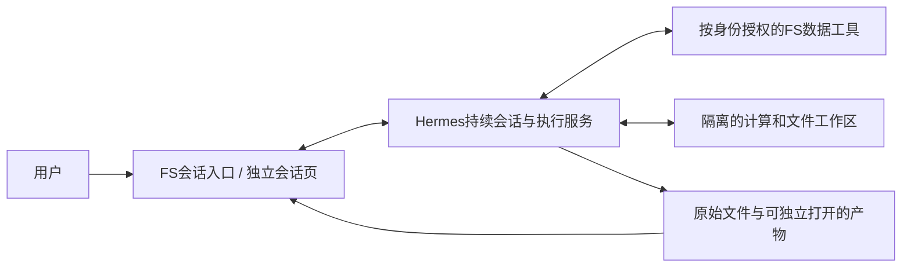

# Hermes 智体中心升级规划

状态：2026-10-18 首期代码和受控发布候选正在准备，尚未合并、发布或完成真实会话验收；下文为最初的产品规划，首期权限以文末修订为准。现有日报已获用户验收；周报另行重做，不拿技术检查代替用户验收。

## 推荐形态

把 Hermes 做成可以持续交谈、自己选择工具并交付结果的助手。FS 是业务数据与工具提供方，也是一个可选入口；它不定义每类问题的固定执行脚本、章节或渲染模板。

用户打开后直接说话：可以问一个问题，也可以布置调查；Hermes 能在同一会话中澄清、取数、计算、解释并制作文件。简短回答直接显示，长任务先说明当前正在做什么，产物生成后立即出现打开/下载入口。不要求先选日报、日期或模式，不把每句追问转换成新报告。周期报告作为会话中的快捷能力，保留已有后台调度。

独立会话页采用同一身份体系和同一会话，不做第二个脑、第二份记忆或重复任务。首期不再引入一套第三方聊天平台；以后换客户端也不更换会话身份和业务工具合同。

## 为什么现在像派单

本轮已核当前维护源码 `fs_hermes_data_workspace_20261018/hermes/source/brain.js`：`conversation()` 仅对已完成且 `can_followup` 的任务开放追问；提交附带 `parent_report` 生成新版本；`refresh()` 每15秒轮询，页面隐藏时暂停。controller按报告任务组织取证、生成和归档。这适合异步报告，但无法仅靠聊天气泡变成实时助手。

已核三个服务当前运行；现有Desktop连接及业务研究worker分别有配置与权限边界。历史活动链路记录的Hermes版本为0.21.7，不能当本轮最新API能力已验证。当前Desktop管理服务涉及高权限文件访问，绝不把它的管理token或完整文件API直接暴露给普通FS会话。

官方目前提供流式回复、工具进度、会话与runs接口，可作为复用候选；实际实施先核活动版本及协议兼容，不能照最新网站文档盲接旧运行时。参考：[官方API Server](https://hermes-agent.nousresearch.com/docs/user-guide/features/api-server)、[官方Desktop](https://hermes-agent.nousresearch.com/docs/user-guide/desktop)。本方案选择优先复用官方会话/执行能力，FS只加薄的身份与工具适配，不自建编排引擎。

## 首期必须打通的体验

| 场景 | 应有表现 | 后端原则 |
|---|---|---|
| “今天先看什么？” | 直接交流，必要时自选数据工具 | 不自动塞进整份日报快照；按需取证和计算 |
| “再看看30%新客优惠” | 继承当前上下文，说明判断与下一步 | 同一conversation，区分本轮turn与后台run |
| “查这批客户，后面每周看复购” | 先明确对象、周期与成熟条件，再建立观察 | 查询可直接做；持久观察用已有授权工具，准确回执，避免重复建组 |
| 调查执行中补一句 | 显示已收到补充，在安全边界调整下一步 | 不偷偷并发另起同样任务；已在进行的外部写入不假装撤回 |
| 停止、刷新、断网重连 | 可停止，回来仍看见原进度/结果 | 真实取消、事件续读、幂等提交；未知结果先对账 |
| “做成报告/Excel” | Hermes自主选内容与呈现，出现文件卡 | 原始字节归档；同一文件可FS内预览、新标签页、下载 |
| 关闭页面去做别的 | 任务继续，回来能读到已完成结果 | 长任务由服务管理，不依赖前端标签页存活 |

页面只需要会话列表、消息区、输入框、任务进度与产物入口。快捷提示是可删改的建议，不是必填表单。工具细节默认折叠，但当前动作、失败和需要用户决定的事项必须可见。展示实际进度，不伪造百分比；简短过程摘要不冒充模型内部完整思考过程。

## 自由度与安全各管一层

- **模型负责**：是否调用工具、如何调查和计算、提出替代解释、推荐方案、选择文字/HTML/表格/其他文件、视觉与交互。只约束真实性、可读性和用户明确规则，不强制章节与图表数量。
- **运行环境负责**：每用户/会话隔离的非root工作区、资源与文件大小限制、凭据服务端保管、只授予当前身份可用工具。报表HTML运行于无凭据隔离环境，不能拿页面脚本调用业务写接口。需要联网的交互另走显式能力，不把凭据塞进报告。
- **工具负责**：沿用Admin优先/Order补缺、来源与日期、分页覆盖、优惠与cohort分母，允许模型自主组合；改价、退款、订单修改、对外发送等有实际影响的工具按具体授权执行。不能把“自由思考”扩大为root、任意生产命令或跨用户数据访问。
- **记忆负责**：会话上下文即时续接；业务事实带来源日期；长期方法只沉淀已确认规则，保留版本与撤回能力。失败草稿和待证假设不自动变成事实，旧示例数字不作为新数据。

HTML、图片、PDF和表格可按MIME安全预览；未知格式可下载。文件清单只记录最小元数据（所属会话/任务、类型、名称、大小、SHA、访问主体、时间），不规定文件正文结构。独立打开仍经过身份与访问控制；确需对外分享时再决定接收对象与有效期，不能默认公开经营资料。原稿版本保留，新版不覆盖旧链接。

## 最小实施顺序

1. **确认复用点**：核当前Hermes版本、官方会话/流式/取消接口、工具注册及事件语义；确认现有账号映射。选择唯一会话入口协议；不同时搭两套SSE/WebSocket后端。不升级整个运行时来修一个页面。
2. **打通一个完整会话**：身份代理 → Hermes会话 → 实时文字/工具进度 → FS只读取数 → 原始HTML或文本返回。先支持现有三类数据工具和报告技能。复用已有文件归档、任务账本、模型用量与互斥保护，不新增平行调度器。
3. **补齐真实使用必需项**：打断与补充、取消、断线续读、刷新恢复、原始文件打开/下载、用户隔离。上下文按需加载，避免一句短问也灌入几十万token的整套历史材料。
4. **接回日常能力**：已有日报/周报/月报、定价研究、观察任务及自动采集以同一工具和产物合同接入。原定时任务先保持，逐条核实新入口后切换；不重发历史任务。

每步先本地/隔离测试，再真实会话验收，合格后合并及受控发布。首期不做插件市场、自动扩权、复杂工作流画布、跨平台通知中台或全站UI重构。FS页面仍遵守站点UI规范；Hermes独立产物视觉自主。

## 放行验收

至少跑通一条真实会话：“查单品 → 解读优惠 → 调整关注点 → 建立/读取复购观察 → 生成报告并打开”。同一会话保持上下文，关键取数实际发生，结果可回源，HTML原稿可离线打开。

必须单独验证：执行中补充不重复调用；取消后确实停止可停止的工作；断线重连不重复提交；刷新恢复原run；两个用户不能互读会话/文件；模型生成HTML不能读取FS登录态；工具失败明确展示且不当成功；未知写入不自动重试；下载与归档SHA一致。界面能键盘使用、浅暗可读、窄屏不横溢。

回滚只切回旧入口和适配器版本，保留会话、产物、任务、用量及观察组；切换前确认运行任务归属，不把进行中的任务迁成重复run。性能以实际首响应、工具事件延迟、首产物耗时记录，不能把页面先显示“正在思考”当实时链路验收。

## 当前尚未做的事

未新增会话服务、未开放Desktop管理接口、未改权限/代理/网络出口、未扩模型自主业务写入；官方最新API与活动版本的兼容性需首期核验。现有已验收日报继续使用，周报本轮新稿单独待用户验收。用户本次人工授权认可先前资料使用，但本轮无需重新导出客户级资料，故不为补审而重跑旧拒绝操作。
# 首期权限修订（2026-10-18）

本任务后续明确收紧首期权限：持续对话、主动取数、生成日报/周报/月报及文件只供管理员；普通用户仅可查看已有授权报告，不能生成新的报告或自由对话。下文早期关于“用户打开后直接说话”和周期报告快捷能力的表述仅描述产品交互目标，不授权普通用户生成。真实放行以活动 FS 身份、服务端管理员判定、会话及产物所有权检查和生产验收为准。

