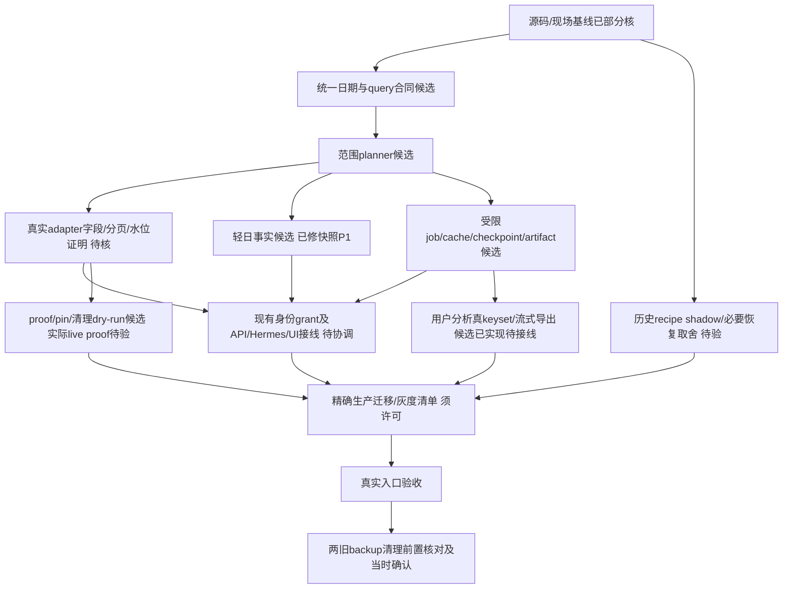

# 04剩余依赖与实际完成边界

| 04项 | 当前实际状态 | 可继续本地工作 | 接线/生产前缺口 |
|---|---|---|---|
| 1基线 | Git与187指定目录/hash/版本已核；全数据集未齐 | 固定活动源差异、消费者映射 | 未覆盖游戏不得称全站；现场读核沿既有许可 |
| 2日期合同 | 独立validator/schema候选 | capability结果schema与共享前端适配fixture | 真实grant来源与T3 A/range_api接口约定；不并改活跃源 |
| 3范围/来源 | planner候选，尚无真实proof | 固定source adapter的受控分页/错误合同测试 | 真实小窗实测须已有scope/负载授权；不扩大3月 |
| 4轻日档 | 原catalog小表/修订候选，读事务P1已修 | 真指标映射fixture、原Archive并发/维护引用测试 | 真实dataset口径/水位、原timer/锁接线及生产DDL许可 |
| 5job/cache | 有界订阅/授权/checkpoint/artifact、generation+revision CAS候选 | 原宿主锁、lease死亡证明/正式引用、同源退避与source适配 | 真实水位、宿主授权/锁接线与部署；默认未接 |
| 6用户历史 | 默认关闭索引候选；c079b3b Linux通过 | 真实writer链fixture及recipe等价shadow工具 | 一致性副本/最小历史取舍，实际索引磁盘/WAL成本与迁移许可 |
| 7分页导出 | 原members真DB keyset/export_iter、v2共享分类集、严格两阶段sink合同已实现候选 | 当前固定包Linux与真库shadow/空间 | 真实epoch/sink/verifier/publisher、旧snapshot迁移与UI接线 |
| 8前端/Hermes | 未接线 | 同policy组件与旧URL/快捷/导出反例 | A拥有range_api/会话材料源，先协调；真实入口验收 |
| 9清理 | 两backup只读清单、protected root/proof/pin-race纯dry-run候选，未删 | live proof、可信引用与负载 | 获批policy后才考虑原锁可逆回收；历史删除单独确认 |
| 10恢复 | 缺库保护候选；30日旧回执仅存在确认 | 故障取舍、fixture恢复、保新写回滚工具 | 约定能力独立恢复验证，避免整包盖新账本 |
| 11发布 | 未推送/合并/部署 | 固定提交审阅、直接测试、精确发布清单 | 最终CI、授权切换与真实使用结果；merge不等于生产 |

目前完成的是可审阅候选，不是数据问题已在生产解决。可独立项继续按依赖实施；生产迁移/切换、真实扩采、新凭据和永久删除另列准确对象申请。不因云Linux较新就忽略现场SQLite3.7；不恢复每日全客户或全库备份，不改变FC定价及依赖资源策略。
